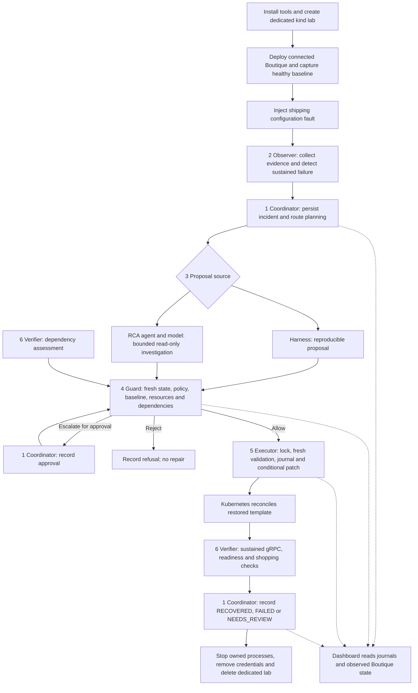

# Architecture and safety boundaries



Each role owns its decisions. The Planner chooses an advisory action, the Guard
authorizes exact inputs, the Executor records what happened, and the Verifier
decides health. Actions are typed: each has a closed parameter schema in
`shared/contracts.py`, its own Guard checks and an Executor handler. Two are
implemented. ROLLBACK writes a specific saved healthy Pod template, not a
repeated undo of the latest revision. RESTART writes that same reviewed template
plus a planner-bound restart token, so Kubernetes replaces every Pod without any
configuration change; the Guard allows it only when the live configuration
already equals the reviewed baseline, Pods are failing and the target's restart
budget has room. Both use the same conditional write and reconciliation. A
RESTART recovery has been tested offline only, against a fake Deployment API;
the production adapter's RESTART patch was accepted once by an API server on a
disposable Deployment (`C-ADMISSION-POLICY-LIVE`). SCALE is in the
contract but refused. Workload-specific limits belong in policy/topology/baseline
configuration.

## Persistence and concurrency

Coordinator lifecycle changes and generated outbox commands commit together in
SQLite. Local workers atomically record results and acknowledge their input.
`services/coordinator/store.py` owns the SQL; `core.py` owns lifecycle decisions.
The separate Executor ledger records immutable action IDs/proposal fingerprints,
attempts, write intent, results and delivery status. Verifier has its own durable
job/sample store. Use one connection per worker.

The Kubernetes API write and execution ledger are not one transaction. Executor
commits WRITE_STARTED before the API call, writes action evidence and the exact
template in one JSON Patch with UID/resourceVersion tests, and reconciles
uncertainty by reading evidence plus live state through a pure decision table
([Executor guide](../services/executor/README.md#the-write-and-ledger-are-separate-commits)).
A write that can no longer commit ends as SUPERSEDED, which the Coordinator
treats as FAILED. An uncertain mutation is never blindly repeated. When fencing
is configured, a write still in doubt at the same resourceVersion is settled by
a conditional, metadata-only fence write: the API server lets only one of the
two commit, so a committed fence proves the write never did (CONFLICT/FENCED). Duplicate
payloads replay saved results; changed payloads under an existing ID are rejected. A refreshed Planner resource version gets a new ID.

OS workload locks and SQLite serialization coordinate one host. The optional
[HTTP delivery layer](../runtime/README.md) has role-scoped claims/leases and
replay handling. A lease alone does not stop a stale Kubernetes write, so the
Coordinator also gives each workload one Executor owner at a time, with an
epoch per claim, and when it withdraws a command an Executor may still be
executing it has another Executor seal the target: a metadata-only patch
with the same resourceVersion test, after which the abandoned patch can
never commit (P3.04; run live only in kind-mode S8 on one kind node,
`C-SEAL-LIVE`). Production deployment remains separate.
The [distributed model](distributed-model.md) states the failure model, why the
Coordinator is a single consistent (CP) leader, how worker results are ordered
by Coordinator sequence numbers rather than clocks, and where a measured clock
skew bound still applies. The [threat model](threat-model.md) maps trust boundaries to
controls and residual risks.

## Guard, approval and execution

Both initial routing and actual execution validate current policy, baseline,
state, resources, dependencies and approval. New dependency findings revoke
stale queued authorization. The Guard decision/report bind the exact proposal
and evidence; their persisted handoff and acknowledgment are atomic. Executor
refreshes dependencies under the workload lock and checks local lifecycle again.
UID/resourceVersion preconditions close stale-write races at the Kubernetes API.
Revocation and a separate API write still require a future fencing design for
strong cross-host guarantees.

Actual repair uses a ServiceAccount restricted to get/patch on the configured
Deployments its Role names. RBAC cannot limit fields, so a ValidatingAdmissionPolicy
for that ServiceAccount (`deploy/sentinel/executor-admission.yaml`) allows only
Pod template changes that carry new action evidence, only the sentinel.io
execution and fence annotations, and no lower fence epoch. It is written and
checked structurally, but has not been verified against an API server, and no
launcher installs it. The trusted lab harness separately holds setup/injection
privileges. The UI gate is not approval, and demo approval is not authenticated
operator access. Hard constraints remain mandatory after any approval.
The separate [approval authority](approvals.md) provides authenticated target
permissions, expiry and persisted revocation. Its current approval reader must
be wired into deployed Guard/Executor workers; the local demonstration does not
acquire these guarantees automatically. Planner `ESCALATE` proposals are stored
as NEEDS_REVIEW without an approval or execution request.

## Observation and outcome

Kubernetes self-healing recreates Pods using the current Deployment configuration;
it cannot correct a persistently invalid desired template. Sentinel restores a
reviewed healthy configuration, then measures application/dependency health.
Readiness alone and a successful patch are insufficient for recovery. In the
connected experiment, cart and checkout must succeed as well as shipping.
Policy may allow a bounded, disclosed convergence grace for callers that are
still reconnecting after the rollout; it defers an unhealthy verdict but
sustained health is still measured afterwards and a relapse fails.

The dashboard projects stored role records, bounded namespace observations and
stage-measured shopping traffic. Its public Coordinator reader opens an existing
database read-only without creating/migrating it. Source freshness and formal
incident outcome remain separate. Schema/ownership details live beside each
role's implementation; shared wire contracts remain in `shared/contracts.py`.
The one canonical JSON encoding and SHA-256 digest that bind proposals,
templates and decisions across roles live in `shared/canonical.py`. Golden
vectors in `tests/test_canonical.py` freeze its output, and
`tests/test_no_duplicate_canonical.py` fails if a copy appears elsewhere.

## Dashboard response contract

`GET /api/snapshot` returns JSON for the frontend types in
[`dashboard/src/lib/types.ts`](../dashboard/src/lib/types.ts). This projection is
separate from the shared role-message contracts. Backend/frontend owner agreement
is still an explicit acceptance item in issues #22/#24; this description and the
mock examples provide material for that review, not owner sign-off.

| Field | Meaning |
| --- | --- |
| `generated_at`, `mode`, `limit` | UTC response creation time, `recorded/live producers` or `synthetic`, and the per-list record bound (600). Response time does not establish observation freshness. |
| `sources` | Per-source `connected` and optional safe `detail`. Connection means the journal was readable, not that a workload is healthy. Optional Boutique/security sources appear when their tables exist. |
| `incidents`, `actions`, `messages`, `approvals`, `outbox`, `reports`, `transitions` | Public Coordinator read projection. Incident lifecycle is recorded state; an `APPLIED` execution alone never implies `RECOVERED`. Messages retain their shared contract payload under `message`; approvals retain their public projection under `record`. `transitions` is the append-only lifecycle journal described in [observability](observability.md). |
| `telemetry` | Up to 600 producer events, including full five-part target identity, UTC `at`, component, summary and replica/generation metrics. |
| `cluster_history` | Up to 60 namespace-scoped cluster observations with cluster identity, UTC `observed_at`, source availability, nodes, Pods, warning events and measured resource summaries. |
| `boutique_history`, `security_events`, `lab` | Optional experiment/service observations, bounded security evidence and explicitly enabled lab-gate state. They are not recovery authorization. |
| `approval_requests` | Only with lab controls and `--approval ui`: up to 20 escalated actions the harness offered to the dashboard, newest first, with code-derived facts, the untrusted rationale (at most 1000 characters), status (`PENDING`, `DECIDING`, `APPROVED`, `REVOKING`, `REVOKED`, `EXPIRED` or `CLOSED`), and the approval or revocation the relay recorded. That approval ID, operator and expiry are the relay's copy of what it sent, not a fresh read of the authority. No credential appears here; the approval authority, not this list, decides what the Executor may do. See [approvals](approvals.md#dashboard-approval-panel). |

Lists are newest-first by journal insertion. Bounds apply independently: a related
message or action can fall outside the returned window. `sequence`, where present,
is a journal cursor, not a timestamp. UTC producer timestamps establish freshness;
the UI marks observations older than 15 seconds as stale, separately from transport
disconnection. Nested cluster sources use `status: available/unavailable`, with
optional `partial` and `error_code`. Missing numeric measurements and unknown
readiness remain `null`; consumers must not turn them into zero or healthy values.
Authenticated approval records expose only `action_id`, recorded `decision` and
`protected: true` here. The operator, timestamps, expiry, revocation and audit
history require the authenticated authority; their omission is not evidence of
an approval without an expiry or of current execution permission.

For a representative complete synthetic recovery, including Guard reports and
cluster measurements, use [`fixture()`](../dashboard/src/test/fixtures.ts). The
same-origin runnable fixture mode is `python scripts/dashboard.py --demo`.
An unavailable response has the same required list fields, for example:

```json
{
  "generated_at": "2026-11-11T00:00:00Z",
  "mode": "recorded/live producers",
  "limit": 600,
  "sources": {
    "coordinator": {"connected": false, "detail": "Coordinator database unavailable, busy or incompatible. Retrying."},
    "telemetry": {"connected": false, "detail": "No telemetry journal connected. Start the collector or emit an event."},
    "cluster_metrics": {"connected": false, "detail": "No cluster snapshots recorded. Start the Kubernetes collector."}
  },
  "incidents": [], "actions": [], "messages": [], "approvals": [],
  "outbox": [], "reports": [], "transitions": [], "telemetry": [], "cluster_history": []
}
```

A failed journal source returns an empty list and explicit unavailable metadata
while other readable sources remain visible. The API returns HTTP 503 if it cannot
produce a response at all; the frontend retains the last response with a disconnected
warning and retries. Requests use the same origin, no cache, and no browser-held
Kubernetes credentials or database access. The default server exposes no mutation
routes. Startup and the separate opt-in lab gates are documented in [run](run.md).

Use [testing](testing.md) for acceptance procedures and [Planner mode](planner.md)
for the model configuration and remaining acceptance boundaries. Record each run's
actual results in its generated evidence rather than a versioned progress report.
