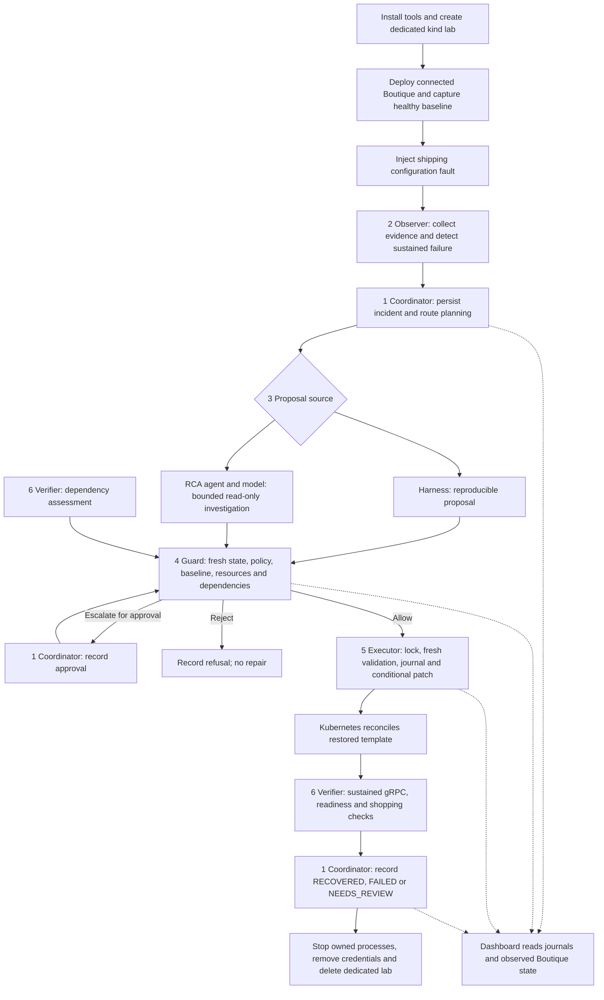

# Architecture and safety boundaries

Each role owns its decisions. The Planner chooses an advisory action, the Guard
authorizes exact inputs, the Executor records what happened, and the Verifier
decides health. The current supported mutation is ROLLBACK to a specific saved
healthy Pod template, not repeated undo of the latest revision. Workload-specific
limits belong in policy/topology/baseline configuration.

## Persistence and concurrency

Coordinator lifecycle changes and generated outbox commands commit together in
SQLite. Local workers atomically record results and acknowledge their input.
`services/coordinator/store.py` owns the SQL; `core.py` owns lifecycle decisions.
The separate Executor ledger records immutable action IDs/proposal fingerprints,
attempts, write intent, results and delivery status. Verifier has its own durable
job/sample store. Use one connection per worker.

The Kubernetes API write and execution ledger are not one transaction. Executor
commits WRITE_STARTED before the API call, writes action evidence and the exact
template in one JSON Patch with UID/resourceVersion tests, and reconciles
uncertainty by reading evidence plus live state. An uncertain mutation is never
blindly repeated. Duplicate payloads replay saved results; changed payloads under
an existing ID are rejected. A refreshed Planner resource version gets a new ID.

OS workload locks and SQLite serialization coordinate one host. They do not
provide distributed leases or fencing. The optional [HTTP delivery layer](../runtime/README.md)
has role-scoped claims/leases and replay handling; those leases do not establish
cross-host Kubernetes mutation ownership. Production deployment remains separate.

## Guard, approval and execution

Both initial routing and actual execution validate current policy, baseline,
state, resources, dependencies and approval. New dependency findings revoke
stale queued authorization. The Guard decision/report bind the exact proposal
and evidence; their persisted handoff and acknowledgment are atomic. Executor
refreshes dependencies under the workload lock and checks local lifecycle again.
UID/resourceVersion preconditions close stale-write races at the Kubernetes API.
Revocation and a separate API write still require a future fencing design for
strong cross-host guarantees.

Actual repair uses a ServiceAccount restricted to the configured Deployment's
get/patch operations. The trusted lab harness separately holds setup/injection
privileges. The UI gate is not approval, and demo approval is not authenticated
operator access. Hard constraints remain mandatory after any approval.

## Observation and outcome

Kubernetes self-healing recreates Pods using the current Deployment configuration;
it cannot correct a persistently invalid desired template. Sentinel restores a
reviewed healthy configuration, then measures application/dependency health.
Readiness alone and a successful patch are insufficient for recovery. In the
connected experiment, cart and checkout must succeed as well as shipping.

The dashboard projects stored role records, bounded namespace observations and
stage-measured shopping traffic. Its public Coordinator reader opens an existing
database read-only without creating/migrating it. Source freshness and formal
incident outcome remain separate. Schema/ownership details live beside each
role's implementation; shared wire contracts remain in `shared/contracts.py`.

Current limits and exact fake/live evidence are in [status](status.md).
