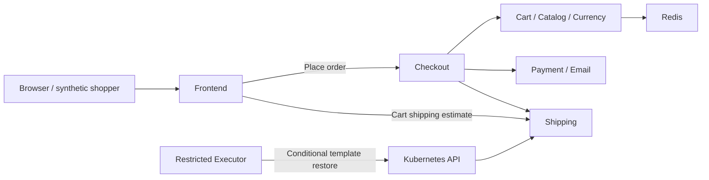

# Connected Online Boutique recovery lab

This opt-in source experiment deploys the real v0.10.7 Boutique application:
frontend, checkout, shipping, cart/Redis, product catalog, currency, payment,
email, advertisements and recommendations. Planner is still harness-authored;
it is not required to test real dependency impact and restricted recovery.

The existing single-service experiment stays available. Connected mode uses its
own `sentinel-boutique-connected` cluster and namespace. Only shippingservice is
an allowed recovery target. It does not grant the Executor write access to the
other Deployments.

## Setup and run

Use Docker Desktop's Linux engine, kind, kubectl, Python and the dashboard build
prerequisites. Full Boutique needs more CPU, memory and downloads than the
single-service lab. The test uses the upstream resource requests/limits for
supporting services; allow enough Docker capacity for all Pods to schedule.

From the repository root in PowerShell:

```powershell
powershell.exe -NoProfile -ExecutionPolicy Bypass -File .\scripts\test-boutique-live.ps1 -Setup -Connected -Dashboard -UIControls -Cleanup
```

Open two tabs after setup finishes:

- **Sentinel:** http://127.0.0.1:8765/#overview
- **Online Boutique:** http://127.0.0.1:8080

In Sentinel, select **Online Boutique** in the sidebar to see all eleven
Deployment readiness cards and the measured shopping journeys. The inventory
collector uses read-only Kubernetes requests on each dashboard collection cycle;
the UI polls every two seconds. Slow API requests can extend that interval.
Cards check desired/ready/available replicas and observed generation. A missing
object or denied read stays unknown; old or disconnected observations are marked
last known. This is separate from the formal Verifier recovery outcome.

The shopping table shows actual homepage, add-to-cart, cart and checkout HTTP
results at baseline, during each injected fault, and during post-action
verification. It includes confirmation evidence and links to the associated
incident. These are stage measurements, not continuous checkout traffic.
The view remains namespace-wide when a shipping incident is selected so affected
supporting services are still visible. Use **Kubernetes** for Pod restarts and
warning events, and the role pages for Sentinel's workflow.

Application log streaming and distributed request tracing are not integrated.
For a second terminal, watch all Boutique Pods:

```powershell
kubectl --context kind-sentinel-boutique-connected -n sentinel-boutique-connected get pods -w
```

Follow one service's application logs when needed:

```powershell
kubectl --context kind-sentinel-boutique-connected -n sentinel-boutique-connected logs deployment/checkoutservice --follow --tail=50
```

The first startup pulls all required images and can take several minutes.
Each application image is resolved to an immutable manifest digest and loaded
into the dedicated kind node. The frontend is exposed through a process-owned
loopback-only port forward, not a public LoadBalancer. If port 8080 is occupied,
use `-StorefrontPort 8081`. Keep it separate from `-DashboardPort`.

The UI enables one scenario at a time:

1. Invalid shipping PORT → observe cart/checkout failure → guarded shipping
   rollback → require real shipping, cart and checkout success.
2. Repeat the fault with an Executor crash after its real write → read-only
   reconciliation → require the same connected recovery evidence.
3. Propose an unnecessary rollback while healthy → Guard rejection and zero
   repair write attempts.

You can browse the storefront manually while the baseline gate is ready. The
test requests use fresh cookie jars and synthetic carts, addresses and payment
details. Boutique's payment/email implementations are demos; use no real data.
The upstream load generator is deliberately omitted so the measured traffic is
explicit and repeatable. This is functional testing, not a load benchmark.

For automatic injection and exit instead of UI gates:

```powershell
powershell.exe -NoProfile -ExecutionPolicy Bypass -File .\scripts\test-boutique-live.ps1 -Setup -Connected -Dashboard -ExitAfterTest -Cleanup
```

The previous packaged TAR does not contain this mode. The current connected
bootstrap is host-based; it explicitly rejects the single-service
`--prepared-environment` configuration. No new connected image or CVE result is
claimed by adding these source files.

## What the connected test proves



This diagram highlights the tested path; `dependency-graph.json` contains the
larger configured graph. It is derived from addresses in the reviewed manifest,
not discovered from traces.

Before injection, shipping gRPC and actual shopping requests establish the
healthy baseline. With shipping broken, the test requires a reachable homepage
and successful add-to-cart alongside failing cart and checkout requests. A
healthy homepage or ready frontend Pod alone cannot establish application
availability.

For post-action Role 6 evidence, every sample includes:

- Actual shipping GetQuote status and valid positive USD quote.
- Shipping UID, replicas, exact approved template and stable configuration.
- Current readiness/observed generation for every supporting Deployment.
- A fresh storefront journey: homepage, add-to-cart, cart shipping estimate,
  checkout and an actual order-confirmation identifier.

The policy requires `storefront-checkout` plus all supporting components in
every reading. A known failed business request cannot become RECOVERED merely
because shipping and the frontend Pods are ready. Missing/timeout evidence stays
unknown. Pre-action dependency assessment uses component readiness; this is
explicitly separate from post-action business-flow verification.

## Evidence and cleanup

Each `data/sentinel/runs/boutique-live-<id>/` folder records:

| File | Meaning |
| --- | --- |
| `connected-manifest.json`, `images.json` | Exact normalized resources and immutable image references |
| `dependency-graph.json`, `dependency-readiness.json` | Configured topology and live readiness inputs |
| `baseline-storefront.json` | Synthetic cart/order baseline evidence |
| `primary-storefront-impact.json`, `crash-storefront-impact.json` | Actual downstream behavior during each fault |
| Each recovery's `post-health.json`, `outcome.json` | Durable Role 6 readings, shopping evidence and formal outcome |
| `lab-session.json`, `dashboard-validation.json` | UI scenario state and existing dashboard assertions |
| `telemetry.sqlite3` (`boutique_observations`) | Bounded Deployment inventory and shopping summaries, exposed read-only in `/api/snapshot` |
| `storefront-cleanup.json` | Port-forward termination evidence |

After inspection, Ctrl+C in the launcher and let cleanup finish. With
`-ExitAfterTest`, teardown happens automatically. The source harness stops its
port forward and removes private Executor credentials; `-Cleanup` removes the
named cluster. Evidence and cached images remain. For interrupted teardown:

```powershell
kind delete cluster --name sentinel-boutique-connected
kind get clusters
```

If a port-forward child remains after force-closing the launcher, identify the
specific `kubectl ... service/frontend` process for this context before stopping
it. Do not terminate unrelated kubectl processes. An operator emergency restore
after a failed test is recorded separately and never counted as Executor success.

## Implementation and scope

- `scripts/boutique_connected.py`: full-workload setup, reviewed graph, live
  readiness, downstream impact measurements and connected verification samples.
- `scripts/boutique_storefront.py`: bounded loopback-only shopping requests with
  fresh sessions and explicit order-confirmation checks.
- `runtime/boutique_observability.py`: projected readiness and shopping summaries;
  no response HTML, cookies or payment inputs are published. Inventory and
  shopping history have separate retention limits so polling cannot evict fault
  measurements. This journal is never an authorization input.
- `dashboard/src/components/boutique-overview.tsx`: namespace-wide service cards
  and the shopping evidence table under **Online Boutique**.
- `scripts/test_boutique_live.py`: selects the connected subclass and reuses the
  existing Observer, Coordinator, Guard, Executor, Verifier and UI sequence.
- `deploy/boutique/upstream.yaml`: unchanged upstream manifest from
  source commit `5b608cb1dfe317d05e4f1bb8c99b7618452fde87`, checked by SHA-256;
  the adjacent license preserves the upstream Apache license.

Reference: [upstream release manifest](https://github.com/GoogleCloudPlatform/microservices-demo/blob/v0.10.7/release/kubernetes-manifests.yaml)
and [frontend request handlers](https://github.com/GoogleCloudPlatform/microservices-demo/blob/v0.10.7/src/frontend/handlers.go).
Normalization removes external exposure/loadgen, disables unused token
automounting and pins images. Supporting application wiring remains upstream;
shipping uses the existing reviewed rollback template configuration.

The recovery core and shared event contracts are unchanged. This remains a
single-node lab with local coordination, a configured dependency graph and one
injected fault type. It does not establish full application coverage, concurrent
fault handling, load resilience, automatic discovery, AI diagnosis or public
cloud readiness. Separate workload images have not been certified by the older
runner's zero-CVE scan.

## Adding other fault targets later

Additional faults are feasible without Planner integration, but this increment
keeps the tested shipping-only recovery boundary. A second recovery target needs
its own measured healthy baseline, scoped Executor permissions, Guard policy,
dependency assessment and post-action application checks. Faults such as deleting
a Pod exercise Kubernetes recreation; a bad Deployment template exercises
Sentinel's configuration recovery. They should be reported as different tests.
Do not widen the current UI scope or RBAC to every service just to add buttons.

## Recorded validation: 4 November 2026

The first successful connected run was
`data/sentinel/runs/boutique-live-20261103T183311Z-d600a1/`. A repeat with stricter extraction
of the upstream `Confirmation #` field passed as
`data/sentinel/runs/boutique-live-20261103T185418Z-6ba362/`. Run identifiers use UTC; both runs
occurred on 4 November in Singapore.

- All **709 Python tests** and six contract fixtures passed offline. Eleven
  connected tests use fake Kubernetes data and local fake HTTP services; they
  cover immutable image selection, upstream checksum, topology/scope, fresh
  shopping sessions, HTTP failures, missing confirmation, failed/unknown checkout
  evidence and a Deployment changing during business measurement.
- Each actual connected run completed **15 real Kubernetes checkpoints** with
  eleven application/Redis Deployments and a configured graph of eleven nodes
  and fifteen edges. No synthetic service replaced an upstream application.
- During both bad shipping rollouts, actual homepage requests returned 200 and
  add-to-cart returned 302, while cart and checkout returned 500. After each
  repair, three measured cart/checkout samples returned 200 with confirmation
  evidence. Both formal Role 6 outcomes and incidents were RECOVERED.
- The post-write crash restart made one read and zero additional write attempts.
  The final unnecessary rollback was REJECTED with zero repair patch attempts.
- Installed Edge clicked all three live UI buttons, each receiving HTTP 202,
  with zero page JavaScript errors. The actual storefront and dashboard were
  rendered and screenshots retained under `data/sentinel/runs/connected-boutique-validation/`.
- Dashboard assertions passed for three incidents, two APPLIED executions, two
  passing outcomes, three dependency results and seven Guard reports. The
  cluster, port forward, dashboard threads and private Executor credentials were
  removed; no kind cluster or container remained afterward.

An earlier setup attempt failed before deploying workloads because kubectl
emitted multiple JSON documents. It was cleaned up, the loader was corrected,
and a regression test now covers that format. It is not counted as a recovery.
The frontend code was reused from the previously tested 72-test UI increment;
this change did not rebuild a runner image or establish a new CVE scan result.

## Observability increment: 4 November 2026

The new **Online Boutique** page was exercised against the actual cluster in
`data/sentinel/runs/boutique-live-20261103T201446Z-ccdc4a/`. All fifteen Kubernetes checkpoints
passed, with two RECOVERED incidents and the final unnecessary rollback REJECTED.
The dashboard assertions checked eleven Deployment entries, both real fault
measurements (homepage 200, cart/checkout 500), and six passing post-action
shopping measurements with order confirmation. The crash restart reconciled
without another mutation. These are real application/API observations, not
fixture-generated results.

Offline checks passed: **714 Python tests**, **78 frontend tests**, six contract
fixtures and the production frontend build. The new offline tests use fake
Kubernetes objects and shopping summaries; they cover uncertainty, generations,
read denial, bounded history, privacy projection, scope isolation and stale UI
observations. Installed Edge checked the actual live service cards and shopping
table, clicked all three injection controls (HTTP 202), opened an incident from
the table, and checked desktop/mobile layouts with no page JavaScript errors or
page-wide horizontal overflow. The wide results table scrolls horizontally on
narrow screens. Screenshots and browser evidence are in
`data/sentinel/runs/connected-boutique-validation/observability-*`.

The dedicated kind cluster, frontend port-forward, dashboard server/collector
and private Executor credentials were removed after the run. Cached images and
evidence remain. This source increment does not rebuild the exported runner TAR,
add multi-service repair permissions, or claim distributed tracing/log hosting.
