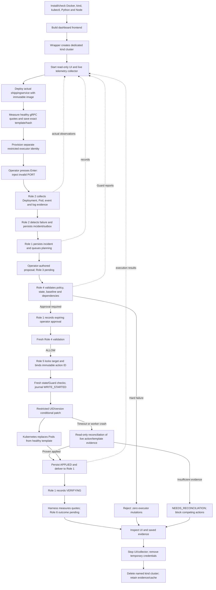

# Current system: team update, presentation script and flowchart

Use the [demo instruction book](boutique-demo-handbook.md) for exact setup,
injection and cleanup commands. This document describes the current tested scope,
not the unfinished final platform.

## What changed for each role

| Role | Existing implementation reused | Integration added for the Boutique demo |
| --- | --- | --- |
| 1 Coordinator | Incident lifecycle, SQLite records, routing, expiring approvals and result ingestion | The Boutique harness delivers real Observer incidents, records approval through the public interface and sends actual execution results. Dashboard reads this exact run's database. Approval expiry support was added earlier with the live executor; no new lifecycle rewrite was needed. |
| 2 Observer | Kubernetes evidence collector, detector, persistent checkpoint/outbox and Coordinator sink | Full collector now reads shipping Deployment, owned Pods, warnings and bounded diagnostic logs. Durable observer state/outbox is used in the experiment. Inconsistent rollout samples receive bounded read-only retries; the failure timer resets on collection gaps. |
| 3 Planner | Shared proposal contract; implementation remains a stub | No Planner implementation added. The harness supplies an explicitly operator-authored proposal. |
| 4 Guard | Evaluator, strict policies, reports, approval checks, live reference reads and admission preview | The same Guard validates actual shipping state/baseline and current approval. Existing Coordinator Guard reports are visible in the connected dashboard. The teammate's evaluator/dashboard design is reused. |
| 5 Executor | Restricted adapter, target allowlist, conditional patch, durable journal, local locks, duplicate handling and reconciliation | Demo harness gained workload configuration hooks; Boutique supplies its own deployment, image, health and fault adapters. Real executor workers run against shippingservice, including a crash after a real patch. The production recovery algorithm was not replaced. |
| 6 Verifier | Shared dependency/outcome contracts; implementation remains a stub | No Verifier implementation added. The harness supplies an isolated-service dependency attestation and independently measures shipping quotes; it does not emit RECOVERED. |

The Guard teammate's existing read-only UI now connects through
`scripts/boutique_dashboard.py`. It serves actual records from the experiment,
collects projected live cluster data without producing a second incident stream,
and verifies the page/API. `scripts/test-boutique-live.ps1` manages setup and
optional cleanup. `scripts/test_boutique_live.py` coordinates the experiment.

## Presentation script: current system

“Sentinel is a Kubernetes incident diagnosis and guarded recovery project. Our
final goal includes LLM-assisted planning and independent outcome verification.
Today's demonstration exercises the implemented safety and execution path using
a real Online Boutique shipping service; planning is supplied by the operator.

“Docker Desktop runs a local kind Kubernetes cluster. The harness deploys the
actual upstream shippingservice image pinned to a resolved manifest digest. It
makes successful gRPC shipping-quote requests and stores the exact healthy Pod
template, its hash and the measured health evidence as the recovery baseline.

“The UI shows real Coordinator records and live Kubernetes telemetry. The
operator then injects a bad PORT configuration. The application fails startup.
Our Observer collects Deployment, owned Pod, Warning event and diagnostic log
evidence, detects sustained failure and durably delivers the incident.

“While the Planner is unfinished, the harness provides a clearly labelled
rollback proposal referring to the stored baseline. The Guard checks actual
state, policy, baseline, resources, dependency evidence and approval. Missing
approval or a hard rejection produces no executor mutation. An approval never
overrides a hard safety constraint.

“The executor uses a separate identity permitted to get and patch only the
selected Deployment. Under local target coordination it rechecks authorization,
journals intent and submits one patch with UID and resource-version tests. It
restores the specific baseline rather than undoing whichever revision happens
to be latest. Kubernetes then replaces the Pods using that restored template.

“The demo also tests duplicate requests, changed payloads under a reused ID,
competing workers and a real process crash after Kubernetes accepted a patch.
On restart, the executor reconciles recorded attempt evidence against live state
without submitting another mutation.

“We measure shipping requests after recovery, but Role 6 is not yet integrated.
APPLIED therefore moves the incident to VERIFYING, not RECOVERED. Finally we stop
the dashboard and collector, remove temporary executor credentials and delete
the named test cluster, preserving experiment evidence.”

## Setup, injection, execution and cleanup flowchart

Solid paths below describe the current experiment. The Planner and Verifier
boxes explicitly identify substitutes rather than completed services.

The actual harness performs refusal/concurrency tests and two recoveries: normal
execution and the post-write crash case. The chart condenses their common path.
Fresh Guard validation also occurs inside the executor's lock immediately before
execution; a previously stored ALLOW alone does not authorize the mutation.

## What is deployed where

| Location | Current contents |
| --- | --- |
| Desktop | Python harness, Coordinator/Observer/Guard/Executor runtime calls, SQLite files, UI server and telemetry collector |
| Docker Desktop | kind node container and image storage |
| Kubernetes inside kind | shippingservice, its ServiceAccount/Service, restricted executor RBAC and short-lived gRPC client Pods |
| Browser | Built React UI reading the loopback dashboard API |

The six responsibility areas are not six independently deployed services in this
experiment. The dashboard is read-only and grants no execution permission.

## Packaged laptop demo

The packaged runner is now implemented. Follow the [packaged demo guide](packaged-demo.md)
for `scripts/demo-start.ps1` and `scripts/demo-stop.ps1`. The image bundles Python,
kubectl and the built dashboard; host bootstrap manages Docker/kind and imports
cached images. The runner joins kind's private network with a TLS-verified
internal kubeconfig, has no Docker socket and writes evidence to a persistent
host mount. This moves the local runtime calls described above into one container;
it does not create six independently deployed microservices.

The host-run diagram and workflow above remain valid for the development route.
The packaged route uses a separate `sentinel-boutique-package` cluster and the
same recovery logic. Administrator setup/injection credentials remain distinct
from the executor's restricted credentials. Planner and Verifier remain pending.

Use the recorded checks in the packaging guide to distinguish validated image,
cluster and browser behaviour from still-unverified second-laptop portability.
