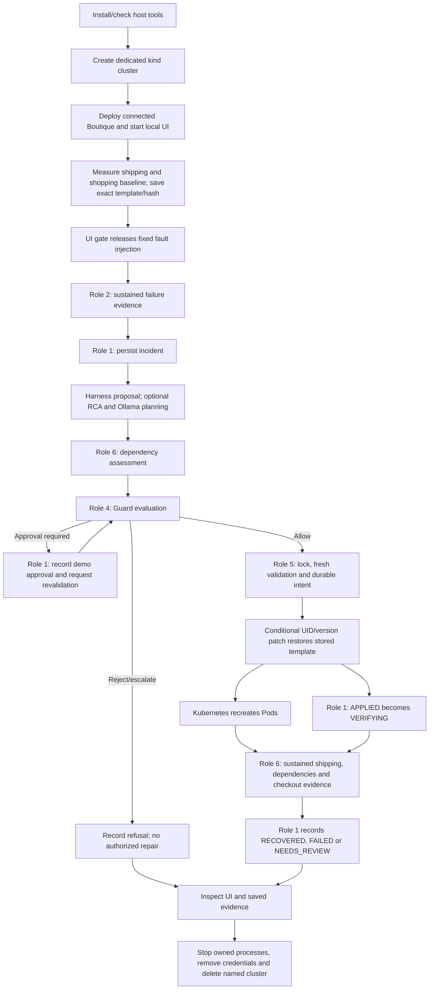

# Current system: roles, explanation and flow

Use [the local demo handbook](boutique-demo-handbook.md) for setup, injection and
cleanup. The default demonstration uses the connected Boutique application and
harness-authored proposals. The optional [live agent recovery mode](boutique-demo-handbook.md#live-agent-recovery-mode)
runs RCA and Ollama planning for one incident through the same guarded path.

## Role coverage

| Role | Implementation in the current connected harness |
| --- | --- |
| 1 Coordinator | Persists actual incidents, proposals, approvals, lifecycle and request/result routing. APPLIED creates verification work; only a passing independent outcome closes an incident as RECOVERED. |
| 2 Observer | Collects shipping Deployment/owned Pod/event/diagnostic evidence, detects sustained failure, persists a checkpoint/outbox and delivers the incident. Namespace inventory covers all Boutique Pods. Optional multi-workload OTLP capability has a separate instrumented validation lab. |
| 3 Planner | Offline runbook/proposal validation and an injected provider boundary exist. The default live demonstration uses explicit harness proposals; optional agent mode diagnoses live Observer telemetry, retrieves recovery knowledge and asks Ollama for a typed decision bound to the measured baseline. |
| 4 Guard | Validates current state, exact baseline, policy, resources, dependency evidence and approval. New dependency evidence revokes queued authorization and requires a newly bound decision/report. |
| 5 Executor | Revalidates under a local target lock, journals the immutable action/attempt, uses UID/resource-version conditional writes and restores the exact approved Pod template. Duplicate IDs replay saved results; changed intent conflicts; crashes reconcile action evidence without blindly repeating a mutation. |
| 6 Verifier | Evaluates configured dependencies and independently checkpoints sustained shipping gRPC, replica/template/identity and actual storefront/cart/checkout evidence before publishing the outcome. |

Six responsibilities do not imply six deployed services: the current accepted
local experiment composes implementations in the host harness and worker
processes. Optional authenticated worker delivery is a foundation; separate
network worker deployment and cross-host ownership are not established here.

## Short presentation script

“Sentinel observes and repairs a real connected Online Boutique application on
local Kubernetes. The storefront, checkout and supporting services are deployed,
while the controlled configuration fault and repair target shipping.

“Before injection, we measure actual shipping and shopping success and save the
exact healthy Pod template and its hash. A dashboard button releases a fixed
harness scenario that injects an invalid startup port. Kubernetes keeps trying
the faulty configuration; our Observer records evidence of sustained failure.

“In the default scenario suite, the harness proposes restoring the saved
baseline. Optional agent mode uses RCA and Ollama to select a recovery decision.
The Coordinator records the proposal and demo approval.
Guard checks live state, policy, resources, dependencies and approval. Approval
cannot override a hard constraint.

“The restricted Executor rechecks authorization under a workload lock, persists
intent and submits a conditional Kubernetes patch. The patch tests the target
UID and resource version and records action evidence with the restored template.
This lets a restarted worker recognise a completed write without repeating it.

“An applied patch is not proof of recovery. Verifier checks sustained shipping
health, supporting Deployment readiness and successful cart/checkout requests.
The Coordinator marks RECOVERED only after that independent outcome. Our other
scenarios demonstrate crash reconciliation and rejection of an unnecessary
rollback without a repair write.”

## Pipeline

## Operational visibility and limits

The UI shows Sentinel's stored activity, namespace Pod status/restarts/warnings,
Deployment readiness and stage-based shopping measurements. It marks old or
unavailable evidence explicitly. Application log inspection uses `kubectl logs`;
there is no claim of complete request tracing or streamed logs for every service.
The dependency graph is derived from reviewed configuration, not automatically
discovered from traces. Metrics usage requires a readable Metrics API.

Security inspection and scheduled CVE alerts are available in a separate opt-in
lab; they are not silently enabled in the recovery demo. Trusted baseline storage,
authenticated human approvals, cross-host Executor coordination, deployment of
remote workers and actual LLM acceptance remain tracked work. The old exported
runner image predates the current connected source.

Agent mode exercises one recovery and retains model calls, diagnosis and the
proposal beside Guard and Verifier evidence. The default scenario suite remains
the path for crash reconciliation and redundant-repair refusal checks. A live
model run must still demonstrate a passing independent recovery outcome before
it is counted as accepted.
