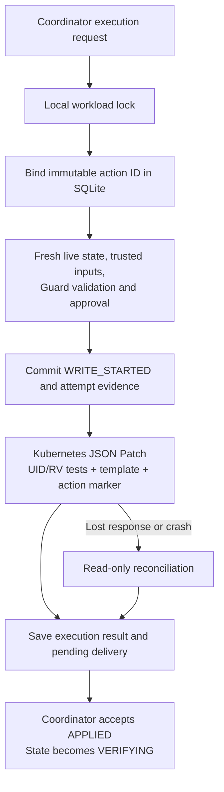

# Role 5: live restricted rollback execution

Role 5 now connects the existing executor to the real Kubernetes API. The core
still owns idempotency, local coordination, the SQLite journal and crash
reconciliation. A live adapter replaces the fake Deployment API, and a runtime
connects it to the actual Guard and current approvals. Existing message formats
and teammate-owned service implementations remain in place.

The first action restores one explicit stored healthy Deployment Pod template.
Proposals cannot supply shell commands or request relative rollout undo. The
transport invokes fixed kubectl argument lists without an operating-system shell.
`APPLIED` confirms execution; Role 6 must still verify sustained health before
Role 1 can mark the incident `RECOVERED`.

## Implementation map

| File | Responsibility |
| --- | --- |
| `services/executor/kubernetes_adapter.py` | Explicit-cluster reads and conditional template/evidence writes |
| `runtime/live_executor.py` | Live CLI, strict Guard inputs, current approvals and optional admission preview |
| `deploy/sentinel/executor-rbac.yaml` | Lab ServiceAccount restricted to the selected Deployment |
| `scripts/test_executor_live.py` | Real-cluster execution experiment and captured evidence |
| `scripts/test-executor-live.ps1` | Windows launch, optional lab setup and cleanup |
| `scripts/install-dependencies.ps1` / `.bat` | Check tools and install missing Windows prerequisites |

The [original executor guide](executor.md) explains the durable core and
Coordinator delivery model. The original operator lab remains an environment
check; the new executor experiment actually invokes Role 5.

Simulation support is isolated under `tests/support/`; production services and
the live runtime do not import it or fall back to a fake API. The superseded
standalone simulated Executor demo was retired. Guard/Coordinator fixture demos
and deterministic failure-injection tests remain useful offline regression
checks and are labelled as such.

## Reproduce the experiment on Windows

Prerequisites are Docker Desktop running Linux containers, kind, kubectl and
Python 3.12+. The Python runtime uses the standard library and kubectl, so no
Kubernetes Python package or API key is needed. The repository uses kind;
Docker Desktop's separate Kubernetes cluster is not required.

From PowerShell in the repository:

```powershell
# Check only; do not install anything.
powershell.exe -NoProfile -ExecutionPolicy Bypass -File .\scripts\install-dependencies.ps1 -CheckOnly

# Install missing prerequisites when needed.
powershell.exe -NoProfile -ExecutionPolicy Bypass -File .\scripts\install-dependencies.ps1

# Prepare the lab, run the live executor checks and remove the cluster afterward.
powershell.exe -NoProfile -ExecutionPolicy Bypass -File .\scripts\test-executor-live.ps1 -Setup -Cleanup
```

Existing compatible tools are kept. Start Docker Desktop and finish any required
first-run/WSL setup before the live experiment. `-Setup` uses the existing lab
setup to create/reuse `sentinel-lab` and deploy `demo-api`; omit it when those are
already ready. `-Cleanup` removes the named lab after the run and retains evidence
under `data/sentinel/runs/`. Execution policy changes only for that PowerShell process.

The Python executor, real Guard and local Coordinator run on the desktop.
Kubernetes runs the demo workload inside kind's node container. The executor
uses a restricted ServiceAccount kubeconfig. A separate operator/admin identity
bootstraps RBAC, injects faults and measures health.

The README also documents [manual installation and environment setup](../README.md#method-2-install-and-set-up-manually).
That route installs tools without the installer, creates the cluster with
explicit kind/Docker/kubectl commands, then runs `python scripts/test_executor_live.py`
against it. Both methods exercise the same live Executor.

## How one recovery works



1. The executor validates the existing proposal contract and allows only
   `ROLLBACK` on a Deployment. The request identifies a baseline ID/hash, full
   target UID and the resource version on which it was planned.
2. A nonblocking OS file lock covers the read/validate/journal/write sequence.
   Its key contains cluster, namespace, kind and name, excluding UID so an object
   recreated under the same name still shares the coordination domain.
3. SQLite binds the action ID to the entire canonical proposal fingerprint.
   Identical completed requests return their saved result; changed content under
   the same ID raises `ActionConflict`. Rationale, evidence and preconditions
   belong to that identity too.
4. The runtime reads current state and reloads trusted policy, baseline,
   dependencies and approval. It requires `profile: live` before the first live
   read for new execution. The actual Guard applies its existing strict baseline,
   security, resource, dependency and approval constraints. Reference metadata
   and optional server admission preview are bound to the same snapshot.
5. Before calling Kubernetes, the ledger commits `WRITE_STARTED`, the checked
   version and a fresh attempt nonce. Approval is reread and decision expiry is
   checked again after journaling. Human approval cannot override a hard failure.
6. The adapter rereads the Deployment, then submits one conditional JSON Patch
   containing UID/version tests, exact template replacement and action evidence.
7. The executor saves the execution result before delivering it to the
   Coordinator. An eligible `APPLIED` result queues verification; it does not
   declare health or recovery.

Resource versions are opaque strings. A stale request is not rewritten to the
new version under its existing ID/approval. Changed intent requires a new action
ID and the normal dependency, Guard and approval route.

Coordinator approvals now accept a backward-compatible optional `expires_at`
keyword and CLI `approve --expires-at`. The live test persists an actual expiring
approval through Role 1's public interface. The runtime's `approval_reader`
rereads that authoritative record at validation and final usability checks. No
approval is inserted directly into another service's private tables.

## What Kubernetes receives

The patch uses this structure, with the complete saved healthy template supplied
as the replacement value:

```text
test     /metadata/uid                   = expected target UID
test     /metadata/resourceVersion       = version checked by Guard
replace  /spec/template                  = exact stored healthy Pod template
add      /metadata/annotations/sentinel.io~1execution = encoded attempt evidence
```

When annotations are absent, the map is added in the same patch. Existing
unrelated annotations are preserved. Both tests and both changes form one object
update: a target changed after validation cannot accept the old conditional
patch, and there is no separate template/marker write gap.

The Deployment annotation `sentinel.io/execution` contains action ID, complete
proposal fingerprint, target UID, template hash and attempt nonce. It lives
outside `spec.template`, preserving the approved template's hash. The adapter
checks the response's identity, changed version, exact template and evidence.
Malformed responses or admission changes trigger inspection rather than an
unjustified `APPLIED` result.

Primary references: [Kubernetes API update conditions](https://kubernetes.io/docs/reference/using-api/api-concepts/)
and [kubectl JSON Patch and patch files](https://kubernetes.io/docs/reference/kubectl/generated/kubectl_patch/).

## Crash reconciliation and result delivery

Kubernetes and SQLite are separate transactions. A worker may die after the API
accepts its patch but before the ledger records completion. On restart, a
`WRITE_STARTED` or `UNCERTAIN` action enters inspection, with no new mutation.
Matching target identity, changed version, exact action evidence and actual
template hash can establish `APPLIED`. A healthy-looking template alone is not
proof: another actor might have installed it.

Missing evidence, changed UID/template, overwritten markers and unavailable
reads remain `NEEDS_RECONCILIATION`. That durable uncertainty excludes competing
actions on the workload even after process death releases the OS lock. A crash
immediately after journaling but before the API call is deliberately conservative:
inspection cannot distinguish it from a sent request whose outcome is unknown.
Further authoritative evidence or manual investigation is required.

Only explicitly transient side-effect-free reads receive bounded retries. A
local pre-read UID/version mismatch produces `CONFLICT` without a submitted
patch. After submission, kubectl's textual error output cannot reliably prove
whether an operation committed. Errors and timeouts therefore trigger read-only
reconciliation. The adapter never automatically retries a mutation.

Saving a result atomically marks it pending delivery in the ledger. The runtime
acknowledges that exact payload only after the Coordinator result or review
commits. A crash between commits repeats delivery; an old worker cannot
acknowledge a newer result. The worker scans unfinished writes and undelivered
completed results even when their routing commands have been canceled.

A newer Guard/lifecycle decision can conflict with historical execution evidence.
`execution_delivery_reviews(store)` retains that evidence for manual lifecycle
review. The runtime does not override Role 1's state or invent a newer execution
timestamp to make an old result fit.

## Team inputs and runtime interface

`runtime.live_executor.build_adapters(...)` returns the existing
`ExecutionAdapters` interface for
`runtime.executor_pipeline.process_executor_requests(...)`. Its injected
`approval_reader` can fetch current authoritative records directly from the
Coordinator. The standalone CLI reads a protected approval file.

| Input | Required content and ownership |
| --- | --- |
| Proposal | Role 3's typed request, immutable action ID and actual target/version/baseline hash |
| Independent target allowlist | Operator-configured execution scope; the proposal cannot expand it |
| Policy | Role 4's reviewed strict live policy |
| Baseline | Exact template, identity/hash, measured healthy-window evidence and reference versions from a trusted producer/store |
| Dependencies | Role 6's linked result, or an explicitly identified operator lab attestation |
| Approval | Role 1's current action/proposal/policy-bound record with bounded expiry |
| Kubeconfig | Restricted execution credentials, supplied independently of the proposal |
| Ledger/locks | Role 5's durable paths, shared by cooperating workers on one host |

The target allowlist is a JSON list of complete identities:

```json
[
  {
    "cluster_id": "sentinel-lab",
    "namespace": "sentinel-demo",
    "kind": "Deployment",
    "name": "demo-api",
    "uid": "replace-with-the-current-reviewed-deployment-uid"
  }
]
```

Changing/recreating a target needs an operator review of that scope. The sample
files' synthetic IDs remain offline fixtures. The live harness generates actual
identities, versions, template hashes and measurements for its run.

For a directory containing authoritative files, use:

```powershell
$run = 'data\sentinel\runs\team-inputs'
python -m runtime.live_executor `
  --context sentinel-executor --cluster-id sentinel-lab `
  --kubeconfig "$run\executor-kubeconfig.json" `
  --allowed-targets "$run\allowed-targets.json" `
  --proposal "$run\proposal.json" --policy "$run\policy.json" `
  --baseline "$run\baseline.json" --dependencies "$run\dependencies.json" `
  --approval "$run\approval.json" --server-dry-run `
  --ledger "$run\executor.sqlite3" --locks "$run\locks"
```

These paths are illustrative and require existing valid inputs. The command
does not create permission or approval. Output aliases of input/credential files
are rejected. Protect these files and keep ledger/lock paths stable on restart.

Read-only inspection of an existing journaled action needs retained scope,
credentials, proposal and ledger, without old authorization files:

```powershell
python -m runtime.live_executor --reconcile `
  --context sentinel-executor --cluster-id sentinel-lab `
  --kubeconfig "$run\executor-kubeconfig.json" `
  --allowed-targets "$run\allowed-targets.json" --proposal "$run\proposal.json" `
  --ledger "$run\executor.sqlite3" --locks "$run\locks"
```

This path cannot start a mutation or execute a merely prepared request. For all
arguments use `python -m runtime.live_executor --help`.

| Exit | Meaning |
| --- | --- |
| `0` | `APPLIED`, or a supported successful saved result such as `NOOP` |
| `2` | `FAILED`: refusal/unavailable required inputs before mutation |
| `3` | `CONFLICT`: stale precondition detected before submission |
| `4` | `NEEDS_RECONCILIATION`: retain workload exclusion and investigate |
| `1` | No result, such as a busy target, changed intent under a reused ID or local storage/configuration error |

## Restricted credentials and their limits

The lab ServiceAccount can only `get` and `patch` the named Deployment in
`sentinel-demo`. It cannot create/delete workloads, execute in Pods, read Secrets
or patch arbitrary Deployments. The experiment creates a short-lived token in a
private kubeconfig, then removes the credential file. Tokens are not printed or
put into the public summary.

RBAC restricts resources, names and verbs, not individual Deployment fields. The
adapter supplies the narrow typed patch, and the Guard checks its candidate.
Preventing a compromised credential from patching other fields on the permitted
Deployment requires admission control or a stronger external execution boundary.
The Role does not claim field-level restrictions.

Workloads using ConfigMaps/Secrets may need narrowly scoped `get` permissions
for referenced-object metadata collection. This demo has no such references and
does not grant those reads. Extend access for reviewed workload references;
avoid broad Secret permissions.

## Live experiment and evidence

The experiment pins the demo to an actual loaded image digest and observes a
healthy HTTP/Deployment window before saving its template/hash. That live
measurement is explicitly attributed to the operator-controlled lab producer.
The harness does not invent Role 6 evidence or weaken strict policy to accept
synthetic sample identities.

kind may expose an imported image under an import-generated repository name.
The setup resolves the manifest behind the exact `sentinel-demo:0.1.0` node image
and registers the same local bytes under an immutable digest reference. Docker's
image-config ID is not substituted for the image manifest digest. This lab keeps
`imagePullPolicy: Never`; it does not publish the demo to a registry. Other
workloads need an available immutable image reference appropriate to their
deployment environment.

The dependency `CLEAR` record is an explicit lab assumption: this standalone
application has no modeled downstream dependencies. It does not demonstrate
dependency discovery. Approval comes from the local operator/test integration,
not authenticated production approval transport.

Scenarios cover positive execution, no-write approval/policy failures, stale
state, duplicate/conflicting IDs, competing local workers and conditional writes.
The crash scenario terminates a child after a real patch but before ledger
completion, reopens the retained journal and reconciles actual object evidence.
Health checks and Coordinator `VERIFYING` are reported separately from API
acceptance. This does not replace Role 6.

The live experiment passed on **25 October 2026**, approximately **06:00–06:03
Singapore time**, using the same `sentinel-lab` cluster created for the earlier
operator experiment. This run actually used the new executor and its restricted
ServiceAccount for recovery writes.

| Live check | Observed result |
| --- | --- |
| Baseline capture | Three successful HTTP/ready-replica samples over at least 10 seconds, actual UID/template hash and immutable image |
| Restricted identity | Selected Deployment get/patch allowed; delete, Secret reads, Pod exec and other Deployment access denied; an actual out-of-scope patch returned Forbidden |
| Missing approval | FAILED, zero executor patch attempts |
| Hard Guard rejection despite approval | FAILED, zero executor patch attempts |
| Stale state | CONFLICT before patch submission |
| Version changes after adapter read | Real Kubernetes API refused the obsolete conditional JSON Patch; template and action marker unchanged |
| Competing worker | Separate Python process received TARGET_BUSY while the workload lock was held |
| Approved recovery | One successful real patch; exact saved template restored; Coordinator VERIFYING |
| Duplicate and changed intent | Exact duplicate returned the saved result; changed content under the same ID raised ActionConflict; write count stayed one |
| Crash after real patch | Child exited with code 73 after successful API write and before ledger completion |
| Restart reconciliation | One read, zero patch attempts; persisted action/template evidence established APPLIED |
| Post-action health | HTTP 200 and one ready replica after both recoveries; Role 6 outcome was not fabricated |

The final offline regression passed **416 tests** and all six sample wire checks.
Of these, 39 additional offline tests cover the live adapter/runtime, bounded
Coordinator approval and kind image-manifest handling. These are offline tests;
the live checks above are separate real-cluster evidence. Three
PowerShell scripts passed syntax parsing. Only Windows/Python 3.15.1 was run
locally; Linux/Python 3.12 remain CI targets.

Local evidence is in
[`data/sentinel/runs/executor-live-20261024T220006Z-06e2dd`](../data/sentinel/runs/executor-live-20261024T220006Z-06e2dd/summary.json).
The directory includes inputs, execution results, HTTP samples, restricted-role
checks, the crash write receipt, restart transport counters, final Deployment,
both SQLite ledgers, cleanup proof and an offline evidence-verification script.
That verification confirmed two journaled attempts and two APPLIED actions,
matching final template/action evidence, zero restart writes and both incidents
still VERIFYING. `data/sentinel/runs/` is Git-ignored: preserve/share sanitized evidence
separately when handing results to teammates. The private token kubeconfig was
removed, and no token is included in the summary.

The dependency installer's read-only check found the existing Docker, kind,
kubectl and Python and a responsive Linux engine. No packages needed installing;
the missing-package installation path has not been exercised on a clean machine.

## Cleanup and remaining integration

`test-executor-live.ps1 -Cleanup` removes the named kind lab after testing and
retains evidence under `data/sentinel/runs/`. The experiment removes its private execution
credential file. Deleting the node container releases the cluster's CPU/RAM;
Docker Desktop and unrelated resources are outside this cleanup scope.
Downloaded image caches may remain on disk.

After the measured run, `sentinel-lab` was deleted. Checks confirmed that its
node container and `kind-sentinel-lab` kubeconfig context were absent. The result
is recorded in the run's `cleanup.json`. Docker Desktop and cached images were
retained; no global Docker prune or unrelated-container shutdown was performed.

Cooperating workers currently share one host, ledger and lock directory. There
is no distributed lease, fencing token or ownership-loss protocol. Kubernetes
preconditions protect object writes but do not replace cross-host coordination.

Approval is reread immediately before writing, but its store and the API are not
one transaction. Changes after the final lookup can still race with execution.
Production authentication, baseline provenance and the precise revocation cutoff
need an agreed Roles 1/4/5 protocol. Uncertain execution and lifecycle delivery
conflicts currently require authoritative evidence/manual resolution.

Planner/RAG generation, automatic dependency analysis and Role 6 sustained
verification remain team work. The original demo-api run above does not establish
whole-Boutique recovery, application independence, load behaviour or the completed
six-component distributed system. A later experiment exercises the same executor
against the actual Boutique shipping service with manual planning; see the
[Boutique instruction book](boutique-demo-handbook.md) for its scope and evidence.
