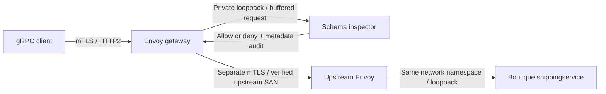

# gRPC inspection and CVE recommendations

This opt-in security lab adds a TLS-terminating reverse proxy, bounded inspection
of unary shipping requests, and read-only image vulnerability scanning. It uses
the actual Online Boutique shipping image in separate Docker Compose networks.
It does not modify an existing kind cluster or redirect the connected storefront.
The [connected security guide](security-connected.md) adds a separate full
Boutique/Calico Kubernetes lab with real caller sidecars, enforced bypass
prevention, a patched candidate and daily scanning/alerts.

Automatic patching is **disabled**. The selected workflow is scan and recommend:
rebuild a reviewed image, run compatibility tests, rescan it, and approve its exact
replacement digest through a separately reviewed deployment workflow. A scanner's
package `FixedVersion` is not a replacement container tag or proof of exploitability.

## Request path



- Both network TLS connections verify a local CA and require client certificates.
  The gateway additionally verifies the upstream's exact DNS SAN. Only host
  loopback port 8443 is published. Envoy admin is not enabled.
- The backend network is internal. The test client belongs only to the front
  network and cannot address the upstream/backend directly. Python inspection
  shares the gateway's network namespace and binds only to loopback port 9001.
- Envoy reassembles HTTP/2 and buffers at most 64 KiB. The private HTTP
  authorization exchange uses `application/octet-stream`, independent of the
  original gRPC content type. This prevents an internal gRPC-style HTTP 200 error
  from being mistaken for HTTP authorization success. Original method and content
  type are independently matched by the route.
- Denial, inspector outage, timeouts, partial bodies and audit-write failures
  block forwarding. No retries or alternate routes bypass inspection.
- Supported RPCs: `hipstershop.ShippingService/GetQuote` and `ShipOrder`. The
  inspector validates exactly one uncompressed gRPC frame, Protobuf wire types,
  lengths and UTF-8; rejects unknown/duplicate singular fields; limits addresses
  to 256 bytes per text field, items to 20, product IDs to 64 permitted characters
  and quantities to 1–100. ShipOrder requires an address.
- Reflection, streaming, compressed requests and other methods are denied.
  These business limits are explicit lab policy, not general malware signatures.
- Audit records contain time, recognized method, verdict, rule, byte count and
  allowed item count. They omit raw payloads, product values, addresses, headers,
  cookies and certificates. Envoy logs route name, result and timing only.

The core is `services/grpc_inspection.py`; its private HTTP adapter is
`runtime/security_inspector.py`. Docker configs and temporary certificates are
generated by `scripts/security_lab.py`, rather than storing private keys in Git.
The two-day local CA is not a production PKI or per-user authorization service.

## Run the isolated lab

Requirements: Docker Desktop Linux engine with Compose, Python 3.12+, and OpenSSL
on PATH. OpenSSL generates local test certificates; it is not used to intercept
third-party traffic. Run from the repository root:

```powershell
python scripts/security_lab.py start
```

This builds the non-root inspector, pulls digest-pinned Envoy/Boutique/grpcurl
images, creates private material under `data/sentinel/runs/security-lab`, and runs real gRPC
checks. It leaves this lab running for inspection. No Kubernetes credentials or
Docker socket are mounted into these containers. Re-run validation and stop with:

```powershell
python scripts/security_lab.py test
python scripts/security_lab.py stop
```

Saved evidence remains. A fresh start requires a new directory, for example
`--directory data/sentinel/runs/security-lab-2`; supply that directory to test/stop as well.
The Compose project name is fixed, so only one security lab runs at a time.
Stop the previous run before preparing another. Existing Boutique clusters and
their images are outside this cleanup scope. Do not share the generated keys.

## Detect CVEs and recommend fixes

The scanner pulls an exact Trivy 0.76.1 manifest and scans a **remote image
manifest digest**, rather than relying on a mutable tag or local configuration
image ID. The scanner has no Docker socket, kubeconfig, host registry credentials
or repository source mount. Its root filesystem is read-only; its only writable
host mount is a private temporary report/cache directory removed after scanning.
Public registry and database access require network access.

Use the actual shipping manifest recorded by the lab:

```powershell
$images = Get-Content .\data\sentinel\runs\security-lab\images.json -Raw | ConvertFrom-Json
python scripts/scan_image_security.py --image $images.shipping --output data/sentinel/runs/security-lab/shipping-scan.json --journal data/sentinel/runs/security-lab/data/telemetry.sqlite3
```

The same command can scan `$images.envoy`. For another workload, supply its exact
public `repository@sha256:manifest-digest`. Private registry credential handling
and automatic cluster image discovery are not included.
Local image archive scanning is available with `--local-image`; the connected
guide explains its OCI identity binding. Automatic live inventory discovery is
still outside this fixed lab.

The command returns 0 for `NO_KNOWN_CVES`, 1 for `FINDINGS`, and 2 for `UNKNOWN`.
All severities and unfixed findings are included; no custom ignore/VEX policy is
applied. Unknown is also written to the journal on a failed or incomplete scan,
replacing an earlier clean result in the UI. Reports are bound to the requested
artifact and manifest. The scanner database is downloaded on each run; this is
an on-demand check, not a background monitoring service.

Recommendations show the advisory ID, severity, package, installed version and
vendor-listed fixed versions. Missing fixes remain explicit. The code contains
no image replacement, package installation, repair action or approval endpoint.

## Review in the dashboard

```powershell
python scripts/dashboard.py --telemetry data/sentinel/runs/security-lab/data/telemetry.sqlite3 --port 8766 --open-browser
```

Select **Security**. It reads inspection decisions and the latest scan per image
from the selected journal. These records have their own image/proxy scope and
are not affected by incident or cluster filters. The other role tabs need their
normal producer databases; absent Coordinator data remains unavailable.

## Validation and remaining integration

The isolated live checks cover a successful quote over both mTLS connections,
invalid-quantity rejection, missing client certificate, wrong server identity,
backend isolation, inspector outage, host loopback TLS/ALPN and actual recorded
inspection decisions. Offline tests exercise malformed/ambiguous Protobuf,
framing/body bounds, audit failure, scanner evidence binding, stale clean-result
replacement and dashboard display.

Before shared Kubernetes deployment, supply real workload identities and PKI
rotation/revocation, gateway availability/capacity/rate controls, an enforcing CNI
with ingress policy, and client changes to route through and authenticate to the
proxy. Default kind networking alone must not be presented as enforcement of
Kubernetes NetworkPolicy. Extend/review each service's schema and streaming policy
before widening routes. Response-body inspection, general IDS signatures and
automated remediation remain outside this first implementation.

### Recorded validation: 4 November 2026

The recorded evidence paths below predate the data-layout migration; current
commands use `data/sentinel/runs/`.

Source is based on main `b5266ff`, with this feature kept on `security-hardening`.
All **734 Python tests**, six shared contract fixtures, frontend type-check/build
and **81 frontend tests** passed. The existing bundle-size warning remains.

Actual run `runs/security-validation-20261104-complete/` passed all eight live
checks listed above using the real shipping manifest
`sha256:3984397422ef1b45bd8a7c6736f935f4b6a41a1724ea39f9563b26733ed633e4`.
Both TLS legs used verified certificates; the host listener was verified with
Python's strict X.509 checks and HTTP/2 ALPN. Existing kind clusters were not
modified by this experiment.

The final non-root Trivy scan in
`runs/security-cve-20261104/shipping-final.json` found **23 package findings**:
5 High, 13 Medium, 1 Low, 4 with unknown severity and 0 Critical. Advisory IDs
can occur in multiple packages, so this is not a count of distinct CVEs. Results
and vendor-listed package versions are scanner evidence at this point in time,
not proof that every finding is reachable or that a particular replacement image
is safe. No patches were applied. The read-only dashboard snapshot returned 200
and exposed the real inspection records and scan report.

References: [Envoy external authorization](https://www.envoyproxy.io/docs/envoy/latest/configuration/http/http_filters/ext_authz_filter),
[HTTP authorization API](https://www.envoyproxy.io/docs/envoy/latest/api-v3/extensions/filters/http/ext_authz/v3/ext_authz.proto),
[Boutique shipping schema](https://github.com/GoogleCloudPlatform/microservices-demo/blob/v0.10.7/protos/demo.proto),
[Trivy 0.76.1 release](https://github.com/aquasecurity/trivy/releases/tag/v0.76.1).
