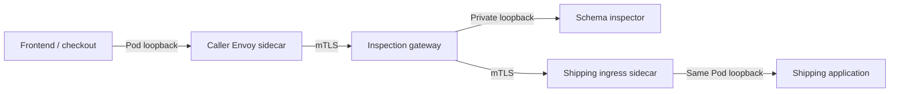

# Connected Boutique security validation

The dedicated `sentinel-boutique-security` kind cluster runs the full 11-service
Online Boutique application. Shipping calls from the real frontend and checkout
service pass through schema inspection. Calico 3.33.0 enforces ingress policy;
this does not rely on an unenforced NetworkPolicy in default kind networking.
Existing Boutique and Executor labs remain separate.

## Detection actually implemented

| Layer | Method | What it establishes |
| --- | --- | --- |
| Shipping traffic | Deterministic positive validation of gRPC framing, Protobuf schema and configured bounds | Whether a request conforms to the reviewed shipping policy |
| Image vulnerabilities | Trivy package/version matching against vulnerability databases | Known advisory findings for the scanned artifact, with vendor-listed fixes |
| Kubernetes Observer | Stateful threshold rules, correlated by workload UID and rollout, with a sustained failure window | Persistent rollout/readiness failures rather than one transient sample |
| Security alerts | Persisted rule/state transitions and deduplication | High/Critical CVEs, unrated findings, failed scans and recent inspection denials |

There is no ML classifier, anomaly-learning model, general IDS signature engine
or antivirus engine. A business-rule rejection is not proof of malware. SHA-256
is used for identity binding, integrity and deduplication, not as a threat model.

No EICAR files/references were found in the checked upstream v0.10.7 source at
`5b608cb1dfe317d05e4f1bb8c99b7618452fde87`. Online Boutique is a sample storefront.
EICAR tests antivirus recognition; it does not validate our Protobuf rules, CVE
matching or TLS identity policy. No EICAR file or real malware was introduced.

## Actual traffic path and enforcement



The callers use `SHIPPING_SERVICE_ADDR=127.0.0.1:50052`; their Envoy listeners
bind to loopback. The gateway authenticates exact permitted client DNS SANs as
well as the CA. It sends only inspected requests to `security-upstream:8444`.
That Service selects the shipping Pod's ingress sidecar, which verifies the
gateway identity and forwards over `127.0.0.1:50051` in its own Pod.

Shipping ingress allows only the gateway on 8444. No Pod is permitted network
access to the application's plaintext port 50051, including through the original
shipping Service. The gateway permits only the two reviewed callers and the
bounded test client on 8443. No inspector port is exposed outside its Pod.
Kubelet/node administration remains part of the trusted cluster boundary.

The two-day certificates have distinct caller identities. Private keys stay in
the run's protected PKI directory and identity-specific Kubernetes Secrets;
only the relevant proxy container mounts each identity. Workloads have no
automounted Kubernetes API token. The inspector has no cluster credentials.

Inspection covers GetQuote and ShipOrder requests. Normal empty-cart quotes
are allowed. Unknown fields, invalid framing/types, unsupported compression or
RPCs, excessive body/item/text sizes and invalid quantities are rejected. No
raw addresses or payloads are journaled. Other Boutique services retain their
upstream behavior; their RPC payloads are not inspected by this shipping policy.

## Build and scan the candidate

Requirements are Docker Desktop's Linux engine, kind, kubectl, Python 3.12+ and
OpenSSL on PATH. No host Go installation or Python packages are needed.

```powershell
python scripts/security/build_security_candidate.py --directory data/sentinel/runs/shipping-candidate
$candidate = Get-Content data/sentinel/runs/shipping-candidate/candidate.json -Raw | ConvertFrom-Json
python scripts/security/scan_image_security.py --local-image $candidate.image_id --output data/sentinel/runs/shipping-candidate/scan.json
```

This checks the upstream release commit, builds with Go 1.27.3 and
`golang.org/x/net` v0.60.0, runs upstream Go tests and uses a resolved, pinned
distroless non-root runtime. The build command does not deploy an image.

Docker's containerd store can identify a build by an OCI index while Trivy
reports a platform configuration digest. Local scans export the selected image,
verify the SHA-256 index-to-manifest-to-config chain for linux/amd64, and bind
the scanner report to that configuration. Neither digest type is silently
substituted for the other. Public remote scans still require an exact repository
manifest digest. Docker Hub's equivalent registry/library aliases are normalized
only while comparing the same repository and exact digest.

## Start, test and review

```powershell
python scripts/security/boutique_security.py start --directory data/sentinel/runs/boutique-security --candidate data/sentinel/runs/shipping-candidate/candidate.json
```

The candidate must have an adjacent successful scan for its exact identity with
zero High/Critical findings. Unrated findings remain visible and require review;
this gate authorizes only this isolated test deployment, not a production release.
Without `--candidate`, the lab uses the pinned upstream shipping artifact.

The script creates only its named cluster, checks the Calico manifest checksum,
prepares the reviewed application images and runs real checkout/security checks.
It then serves:

- Storefront: `http://127.0.0.1:8081`
- Dashboard: `http://127.0.0.1:8767/#security`

The validation records baseline checkout, allowed mTLS RPC, invalid-quantity
denial, missing/wrong client identity, direct Service/Pod-IP bypass, caller
loopback isolation, proxy outage and outage-time bypass. It restores the proxy
and checks checkout and a fresh empty cart. Bounded startup/reconnection attempts
are retained rather than discarded. The traffic is synthetic; Boutique's payment
and email services are demos.

To rerun tests against a retained run, close the current launcher first:

```powershell
python scripts/security/boutique_security.py test --directory data/sentinel/runs/boutique-security
```

To reopen the UI/forward without injecting faults, use `serve` with that run
directory. It requires an existing passing validation. The dashboard shows
current cluster inventory and recorded security evidence; this launcher does not
run Coordinator/Guard/Executor recovery. Existing recovery experiments keep their
separate entry points and contracts. The added Pod sidecars/Secret references
need a reviewed Guard policy and evidence/RBAC handoff before combining workflows.

## Daily scans and alerts

```powershell
python scripts/security/watch_security.py --inventory data/sentinel/runs/boutique-security/scan-inventory.json --journal data/sentinel/runs/boutique-security/telemetry.sqlite3 --directory data/sentinel/runs/boutique-security/scans --interval-seconds 86400
```

The inventory is the immutable image set captured at deployment, including local
candidate/inspector IDs; it is not automatic discovery of later cluster changes.
Refresh it before changing the configured workloads/images. A scan cycle runs
immediately, then every 24 hours after completion while the monitor is running.
`--once` runs one cycle. The interval is bounded to five minutes through seven
days. Monitoring must be restarted after a host reboot; no Windows startup task
or service is installed.

One worker holds a journal-scoped OS lock. Sequential scans share a private DB
cache; Trivy retains its normal database update checks, with no skip-update flag.
Java analysis can download an approximately 1 GB metadata database on first use;
downloads use private disk-backed temporary storage, not the bounded `/tmp` RAM
mount. Leave sufficient disk space for the database/cache and image archives.
Each report is fresh and identity-bound. A failed image becomes UNKNOWN and
does not stop the remaining images or resolve an existing CVE alert. Raw scanner
inputs/cache stay inside dedicated mounts; no Docker socket, kubeconfig, host
registry credentials or source tree is supplied to the scanner.

The main monitor loop checks denials independently while scans run. Alerts and
their open/resolved transitions persist in SQLite, with duplicate suppression
across restarts. Notifications are local dashboard records, not outbound emails
or webhooks. High/Critical findings and unrated findings have separate alerts.
Lower-severity findings remain in the scan tables. The dashboard marks a monitor
heartbeat older than 45 seconds as stale and does not imply an active scheduler.

Request monitor shutdown after its current bounded scan:

```powershell
python scripts/security/watch_security.py --stop --journal data/sentinel/runs/boutique-security/telemetry.sqlite3 --directory data/sentinel/runs/boutique-security/scans
```

Stop the named cluster and request owned UI/monitor shutdown:

```powershell
python scripts/security/boutique_security.py stop --directory data/sentinel/runs/boutique-security
```

Evidence/images remain. The matching run directory matters for host process
shutdown. Each UI run records its PID/port-forward PID; each monitor records its
PID. A fresh start uses a new directory, after stopping the previous named lab.

## Recorded validation: 4 November 2026

The recorded evidence path below predates the data-layout migration; current
commands use `data/sentinel/runs/`.

Actual run: `runs/boutique-security-20261104-complete/`. All 11 application
services were ready; actual frontend and checkout shipping requests appeared in
the metadata audit. Real checkout, empty cart, rejection, TLS identity, Pod/Service
bypass and proxy-outage/restoration checks passed. All network shipping hops used
TLS; plaintext links were loopback-only. The dashboard returned HTTP 200 with
real service inventory, cluster samples, security events and scan/alert records.

The shipping baseline had 23 package findings: 5 High, 13 Medium, 1 Low and
4 unrated. Candidate `sha256:dfa63387fff5cde5632ea9ab7cd3c133367861f717d8afd2e3f48822d1d720f3`
had 0 High/Critical/Medium/Low and 3 unrated findings. It was deployed only in
the security validation cluster. Other application image findings are reported
for their owners; they are not automatically patched. These point-in-time scans
do not establish exploitability or absence of unknown vulnerabilities.
The offline suite passed 747 Python tests and six contract fixtures; frontend
type-check/build and 83 tests passed. The existing bundle-size warning remains.
The configured scan inventory covers application/proxy images, not host, kind
node or CNI operating-system certification.
All 13 configured image scans completed with no UNKNOWN scan statuses after the
Docker Hub alias and Java download-storage corrections. Across those images the
scanner reported 10 Critical and 144 High **package findings**, including repeated
advisories in separate images/packages. These remaining upstream findings are
visible recommendations and alerts; they were not silently dismissed or patched.

PKI rotation/revocation, shared-cluster admission/hosting, high availability,
additional RPC schemas, response inspection and a general malware engine remain
separate work. No PR or merge is part of this change.

References: [upstream Boutique](https://github.com/GoogleCloudPlatform/microservices-demo/tree/v0.10.7),
[EICAR purpose](https://www.eicar.org/download-anti-malware-testfile/),
[Calico on kind](https://docs.tigera.io/calico/latest/getting-started/kubernetes/kind).
