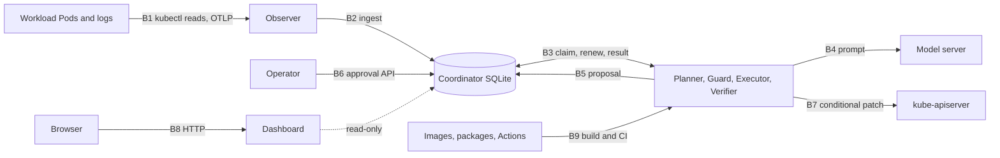

# Threat model

This describes the code as it is on this branch. It was written from the code,
not from a penetration test. `scripts/check_doc_citations.py` checks, in CI,
the backticked spans that look like paths: files, line ranges, symbols, text
and claim ids must still resolve, and a Python line citation fails when its
first cited line moves. Prose spans such as `approve()` are not checked, and
no check proves the cited code still does what the text says. The
residual-risk judgements are a draft: the
security and Coordinator owners still need to review and sign them off.

Sentinel runs as a lab on one host: kind nodes and containers in one Docker
Desktop VM. The trust boundaries below are real in the code, but they have
not been exercised across separate machines. The
[distributed model](distributed-model.md) covers ordering, failure and
consistency.

## Assets

| Asset | Where it lives | Why it matters |
| --- | --- | --- |
| Target Deployment's Pod template | Kubernetes; written only by `services/executor/kubernetes_adapter.py::KubectlDeploymentAPI.conditional_restore` | A bad write takes the service down or runs attacker-chosen code |
| Executor patch credential | 1 h token from `experiments/recovery/live.py:326::Experiment.issue_restricted_credentials::--duration=1h`; Role in `deploy/sentinel/executor-rbac.yaml` | The only Sentinel identity that can change the workload |
| Guard-reader credential (P5.05, protected lab only) | 1 h token for `sentinel-guard-reader`, written by `experiments/boutique/harness/protected.py::ProtectedBoutiqueExperiment.issue_reader_credentials`; Role in `deploy/sentinel/guard-reader-rbac.yaml` | Can read the named ConfigMaps and, since P5.06, the cert-manager Certificate that owns the sidecar's Secret (status and spec, no key material); it reads no Secret |
| Lab CA key and identity keys (P5.06, security lab only) | The CA key in the run folder's private `pki` directory, owner-only (`scripts/security/cert_lifecycle.py::make_ca`), and in the cluster as Secrets `sentinel-lab-ca` and `sentinel-lab-ca-2` in the `cert-manager` namespace behind the cluster-wide ClusterIssuer `sentinel-lab-ca` (`scripts/security/cert_lifecycle.py::issue`, `scripts/security/cert_lifecycle.py::rollover`); identity keys in the cert-manager Secrets `security-<identity>`, issued by `scripts/security/cert_lifecycle.py::certificates` | The CA key mints any identity every Envoy trusts. Through the ClusterIssuer and cert-manager's default approver, so can anyone who may create a Certificate or CertificateRequest in any namespace, get either CA Secret or edit the issuer; the Executor and the Guard reader may do none of these (`experiments/boutique/harness/protected.py::rbac_matrix`). An identity key is that workload's mTLS identity |
| Coordinator database and outbox | One SQLite file (`services/coordinator/store.py::SQLiteStore`) | Holds lifecycle state, approvals and queued commands |
| Approval grants and records | `services/coordinator/approvals.py::ApprovalAccess` | Turns an ESCALATE into permission to repair |
| Service bearer tokens | Environment variables named in config (`runtime/service_identity.py::load_identities`) | Each token is a role identity on the Coordinator |
| Executor ledger and locks | `services/executor/store.py::SQLiteExecutionLedger`, `services/executor/store.py::LocalTargetCoordinator` | Stops repeated or concurrent writes |
| Trusted Guard inputs | Policy and baseline files read by `runtime/live_executor.py::LiveGuardAuthorizer` | The Guard is only as good as these files |
| Model prompt context | `runtime/remote_adapters.py::OllamaProvider`; agent mode in `experiments/boutique/harness/agent_live.py` and the remote agent Planner (`runtime/remote_adapters.py::AgentPlannerAdapter`) | Carries workload telemetry to the model |
| Lab control token | `runtime/lab_control.py::LabControl.capabilities` | Releases a fault-injection scenario |
| Images and CI | `deploy/docker/`, `.github/workflows/checks.yml` | Code that runs with the credentials above |

## Actors

| Actor | Trust |
| --- | --- |
| Operator | Trusted once authenticated by a bearer token at the approval API |
| Lab harness | Trusted. It holds the admin kube context for setup and fault injection |
| Role workers (Observer, Planner, Guard, Executor, Verifier) | Authenticated and trusted to follow the protocol. Not Byzantine-tolerant: see "Rogue worker" |
| Workload, its logs and events | Untrusted content |
| Model | Untrusted output; advisory only |
| Other Pods in the namespace | Untrusted |
| Local users and web pages in the operator's browser | Untrusted |
| Base images, packages and GitHub Actions | Partly trusted: pinned by digest, commit SHA or hash, but not otherwise verified |

Out of scope: a malicious Coordinator, a compromised kube-apiserver or etcd,
root or administrator on the host, and the Docker Desktop VM itself.

## Trust boundaries

| Boundary | Transport and authentication | Code |
| --- | --- | --- |
| B1 Telemetry to Observer | kubectl with a read-only Role; optional OTLP/HTTP JSON receiver, loopback by default, bearer token off loopback, no TLS | `deploy/sentinel/observer.yaml:7-25::sentinel-observer-reader`, `runtime/otlp_receiver.py::make_receiver` |
| B2 Observer to Coordinator | Local SQLite in every recorded run; optional HTTPS `ingest` with a bearer token | `runtime/observer_pipeline.py::LocalCoordinatorSink`, `runtime/remote_worker.py::RemoteIngress` |
| B3 Coordinator and workers | HTTP on loopback or HTTPS (server certificate only) with a per-identity bearer token | `runtime/worker_http.py::handler`, `runtime/worker_transport.py::Delivery` |
| B4 Planner to model | Plain HTTP to the configured Ollama URL | `agent/llm.py::Ollama.ask` |
| B5 Planner output to Guard | Closed message contract, then Guard checks | `shared/contracts.py::validate_message`, `services/guard/core.py::_evaluate_core` |
| B6 Approval API | Same token scheme as B3, on its own port and with its own credentials | `runtime/approval_http.py::handler`, `runtime/coordinator_server.py:91-92::main::& set(secret` |
| B7 Executor to kube-apiserver | kubectl with a restricted kubeconfig; optionally (P5.08, live wedge comparison) the Executor's own HTTPS client with the same credentials | `services/executor/kubernetes_adapter.py::KubectlDeploymentAPI`, `services/executor/rest_adapter.py::KubernetesRESTDeploymentAPI` |
| B8 Dashboard and browser | Loopback HTTP, no user login | `runtime/dashboard.py::make_server` |
| B9 Supply chain | Docker builds and GitHub Actions | `deploy/docker/coordinator.Dockerfile`, `.github/workflows/checks.yml` |

## Threats, controls and residual risk

STRIDE letters: S spoofing, T tampering, R repudiation, I information
disclosure, D denial of service, E elevation of privilege. "Roadmap" names the
item in the remediation plan that addresses the residual risk, or says there is
none yet.

| Boundary and threat | Existing controls | Tests | Residual risk | Roadmap |
| --- | --- | --- | --- | --- |
| B1/B4 T, E: a malicious log line steers the model (prompt injection) | Model output is advisory. The Planner keeps ROLLBACK only if it names an eligible saved baseline, and keeps only evidence ids from the incident (`services/planner/core.py:249-254::propose::and not any(`). A provider may name RESTART only with empty parameters; the Planner binds them itself, and only when a trusted read shows the live configuration equal to a reviewed baseline (`services/planner/core.py::_bind_restart`). A SCALE is bound the same way: a provider may name it only with empty parameters, and the Planner fills in the replica count recorded with that reviewed baseline and the live template's hash, so no provider or model chooses the count (`services/planner/core.py::_bind_scale`). The Guard enforces the target and action allowlist (`services/guard/core.py:173-178::_state_policy_reasons::policy["targets"]`), the baseline hash (`services/guard/core.py:121-122::_baseline_reasons::digest != baseline`) and refuses a rollback that changes nothing (`services/guard/decisions.py::_rollback_change_checks`). In agent mode, log lines, event messages and signal details are cleaned, templated and quoted under `untrusted_telemetry_evidence` before a model reads them, and a line that matches the instruction-like rules is withheld, leaving only its rule ids and hash (`agent/untrusted.py::quote`, `agent/untrusted.py::suspicious`, `agent/untrusted.py::prompt_incident`, `agent/tools.py:205::Telemetry.run::**quote(r[message])`). The remote Planner worker runs the same rules over the raw incident signals before any model call, escalates a flagged signal by rule without calling the model, and otherwise sends the signals only quoted (`runtime/remote_adapters.py::OllamaProvider.__call__`, `runtime/remote_adapters.py:420::OllamaProvider.__call__::raise PlanningError("SUSPECTED_INJECTION"`). A code-owned gate records an injection finding and escalates by rule without asking the Recovery Planner (`services/planner/agent_provider.py::injection_finding`, `services/planner/agent_provider.py:361::AgentPlanner.__call__::raise PlanningError("SUSPECTED_INJECTION"`), and the Recovery Planner reads cleaned prediction fields, evidence ids and quoted signals, never the Reporter's explanation (`services/planner/agent_provider.py::recovery_context`). The system prompt says telemetry is data (`agent/llm.py::Ollama.ask`), which is not a control by itself | `tests/test_planner.py::PlannerTests.test_provider_cannot_change_identity_select_another_template_or_invent_evidence`, `tests/test_guard_necessity.py::GuardNecessityTests.test_healthy_approved_identical_template_is_rejected`, `tests/test_untrusted_telemetry.py::InjectionGateTests.test_every_attack_in_an_incident_signal_is_gated_and_never_reaches_a_prompt`, `tests/test_untrusted_telemetry.py::InjectionGateTests.test_benign_logs_still_reach_rollback_and_recovered`, `tests/test_untrusted_telemetry.py::CorpusTests.test_benign_lines_give_no_rule`, `tests/test_untrusted_telemetry.py::RemotePlannerTests.test_flagged_signal_escalates_by_rule_without_calling_the_model`, `tests/test_untrusted_telemetry.py::RemotePlannerTests.test_benign_signal_is_quoted_cleaned_and_still_reaches_rollback` | The rules are a pattern list, not a complete defence. A paraphrase they miss reaches the model as a cleaned excerpt, and the model can then be steered to ROLLBACK whenever the code eligibility rule allows one (under the default gated policy: an eligible reason, a rollout symptom, and a recent change that makes the live template differ from the baseline; the Guard allows it if the other checks pass) or to ESCALATE, which blocks automated repair. In agent mode the Reporter's component and reason are chosen from a vocabulary code owns, so a steered diagnosis can only pick a wrong name from that list. A false positive escalates a genuine incident. Provider mode passes the raw planning context to the operator's own provider script, and the offline RCAEval CaseToolkit benchmark (`agent/datasets/casetoolkit.py`) sends upstream tool output, which can include raw log rows, to a model with no gate; neither is covered. Live, the gate has run on ordinary telemetry only: the eight agent runs at 870aa7d and dab3b3f, failures included, recorded no injection finding and no flagged log line (`C-INJECTION-GATE-BENIGN`), so it raised no false positive on those logs. No adversarial line has been injected live, so the gate has not been exercised against an attack outside the offline corpus, and the remote Planner worker's gate has not run live | P2.05, P4.04 |
| B1 S, T: forged OTLP telemetry | Loopback bind by default; a token is required to bind elsewhere; body and decompressed size are capped at 1 MB (`runtime/otlp_receiver.py::make_receiver`) | none cited | Off loopback the token travels over plain HTTP. Anything that can reach the port with the token can add telemetry | none yet |
| B1 T, E: fault-injection and metrics tooling in the connected lab, or a forged usage reading | Installing Chaos Mesh and metrics-server is install only and refuses any context but the connected lab and any name containing sentinel-lab (`experiments/boutique/harness/chaos.py::require_connected`, `experiments/boutique/harness/chaos.py::ensure_chaos_mesh`), and, after one read of the node list, a context whose only node is not the connected lab's (`experiments/boutique/harness/chaos.py::require_connected_nodes`). The Chaos Mesh chart is pinned and injects only into namespaces that opt in (`deploy/chaos-mesh/values.yaml::enableFilterNamespace: true`); the metrics-server image must be pinned by digest (`experiments/boutique/harness/chaos_recovery.py::metrics_server_argv`). Metrics-server usage is Observer evidence only: it is converted exactly, joined to Pods the target owns and raises no alert without full coverage (`runtime/metrics_bridge.py::convert`), and an incident that only a metric alert supports is escalated by a code rule before any provider or model call (`services/planner/core.py::metric_only`). The run deletes only its own chaos object and never strips finalizers (`experiments/boutique/harness/chaos_recovery.py::ChaosRecoveryMixin.remove_chaos`) | `tests/test_boutique_chaos.py::ChaosInstallTests.test_ensure_chaos_mesh_refuses_every_other_context_before_any_command`, `tests/test_boutique_chaos.py::ChaosInstallTests.test_ensure_metrics_server_pins_the_chart_and_the_image_digest`, `tests/test_boutique_chaos.py::ChaosInstallTests.test_installs_refuse_a_context_that_does_not_reach_the_connected_lab`, `tests/test_cluster_metrics.py::MetricsBridgeTests.test_pods_not_owned_by_the_target_are_dropped`, `tests/test_observer_telemetry.py::MetricsBridgeThresholdTests.test_a_missing_pod_gives_incomplete_thresholds_and_no_alert`, `tests/test_planner.py::MetricOnlyTests.test_metric_only_incident_escalates_without_calling_any_provider` | The chaos-daemon runs privileged on the kind node, so anyone who can create chaos objects in the opted-in namespace can disrupt its Pods. The lab's metrics-server skips kubelet TLS verification, so a reading could be forged on the node; a forged high reading can only open an incident that escalates, and a forged low one can hide saturation. Both were installed on the connected lab on 13 Nov 2026 under the user's standing authorisation to run Phases 4-5; the project-owner approval that the recipe asks for before installing the privileged daemon and `--kubelet-insecure-tls` is not recorded. The guarded-recovery runs there are unscored (`C-CHAOS-RECOVERY-C9A44CA`, `C-CHAOS-RECOVERY-29E41F8`) | P4.03 (owner approval, scored trials) |
| B3 S, E: a rogue or compromised worker holding a role token | Tokens are at least 32 printable characters, distinct per identity and compared in constant time (`runtime/service_identity.py::load_identities`, `runtime/service_identity.py::authenticate`). Each role can claim only its own topics and ingest only its own message kind (`runtime/worker_transport.py::TOPICS`, `runtime/worker_transport.py::INGRESS`). Renew and result need the same owner, role and lease token (`runtime/worker_transport.py::Delivery.renew`, `runtime/worker_transport.py::Delivery.finish`). A result must match the claimed request's ids, and a Guard result needs a report bound to current evidence (`runtime/worker_transport.py:292-309::Delivery.finish::validate_message(result)`). Protected approvals are removed from generic deliveries (`runtime/worker_transport.py:219-222::Delivery._claim::has_managed_approval`). The Coordinator's lifecycle checks still apply (`services/coordinator/core.py::_apply`). The Executor ignores the delivered Guard decision and re-runs the Guard locally with its own policy, baseline and approval lookup before writing (`runtime/remote_adapters.py::ExecutorAdapter.process`, `services/executor/core.py:635::execute::authorizer.validate`) | `tests/test_worker_transport.py::TransportTests.test_timeout_backoff_and_role_fences`, `tests/test_worker_transport.py::TransportTests.test_renew_cannot_revive_expired_replaced_or_wrong_role_work`, `tests/test_worker_guard_handoff.py::WorkerGuardHandoffTests.test_managed_approval_is_not_exposed_in_generic_worker_delivery`, `tests/test_approval_access.py::ApprovalAccessTests.test_shared_identity_loader_uses_environment_and_rejects_weak_or_reused_tokens` | A bearer token can be replayed by anyone who copies it, until it is rotated by restarting with a new Secret. There is no mTLS, so the Coordinator cannot tell which machine a token came from. A rogue Verifier can report a false RECOVERED outcome or a clear dependency finding. A rogue Observer can open incidents for any target, because ingest is not scoped by target. A rogue Executor token can report APPLIED without a write; the Verifier still measures health. There is no rate limit, and the HTTP server starts one thread per connection. Per-target ownership (P3.04) limits a rogue Executor to one live claim per workload, not to a workload | P3.05; mTLS for the Coordinator is not on the roadmap |
| B3 T, E: lab fault hooks left in worker and Coordinator code paths | Named fault points, the test clock offset, the file-backed test cluster and the deterministic planner do nothing unless `SENTINEL_FAULT_POINTS` names an existing directory and `SENTINEL_FAULT_CLUSTER` names a lab cluster on a fixed allowlist (`runtime/fault_points.py::directory`, `runtime/fault_points.py::LAB_CLUSTERS`). A worker binds that gate to its own configuration: with any lab variable set it refuses to start unless its configured `cluster_id` is the gated lab cluster and any context is that cluster's lab context, and the original lab cluster is always refused (`runtime/fault_points.py::bind`). A worker refuses a `file:` cluster and the deterministic planner outside a bound lab run (`runtime/worker_service.py::lab_cluster`, `runtime/worker_service.py::planner_provider`). A point can only stop or exit its own process | `tests/test_fault_points.py::FaultPointTests.test_inert_without_the_variables_an_allowlisted_cluster_or_the_directory`, `tests/test_fault_points.py::FaultPointTests.test_bind_ties_the_gate_to_the_configured_cluster_and_context`, `tests/test_worker_service_lab.py::LabWorkerTests.test_a_file_cluster_is_refused_outside_a_lab_fault_run`, `tests/test_worker_service_lab.py::LabWorkerTests.test_a_worker_aimed_at_any_other_cluster_refuses_to_start_while_the_gate_is_set` | The clock offset feeds the whole clock of a bound worker: the Guard, Executor and Verifier clocks, including the Executor's snapshot stamps and its local Guard re-check (`runtime/worker_service.py::adapter`, `runtime/live_executor.py::build_adapters`), and the clock it measures its offset from the Coordinator with, so it can change freshness and expiry decisions and the measured offset; that is its purpose in a lab run. Anyone who can set a worker's environment can stop it at a point, which is no more than a process kill allows. The connected kind lab is on the allowlist, so a worker configured for it with the variables set runs its hooks and offset. The Coordinator has no cluster in its configuration, so its one point is gated by the two variables alone; it can only stop or exit the Coordinator | none yet |
| B3 S, T: a forged or malformed `traceparent` header | Parsing is strict and returns nothing for any malformed value, so a new trace starts (`shared/tracing.py::parse_traceparent`). The Coordinator reads the header only after authentication and only when exactly one is sent (`runtime/worker_http.py::inbound_trace`). Trace context labels log lines only: no authentication, permission, claim or transition reads it (`services/coordinator/core.py::record_message`) | `tests/test_tracing.py::ParseTests.test_malformed_values_are_ignored_without_raising`, `tests/test_tracing.py::TransportTests.test_a_forged_header_from_an_unauthenticated_request_is_never_logged`, `tests/test_tracing.py::TransportTests.test_malformed_or_repeated_headers_open_no_span_and_grant_nothing`, `tests/test_tracing.py::StoreTests.test_the_traceparent_never_changes_a_decision` | An authenticated worker can send a wrong context and so mislabel its own spans and the commands that follow them; the stored context is not signed. Only file-mode runs (a file-backed fake cluster, separate processes on one host) have produced a trace (`C-TRACE-FILE-679EF29`) | none yet |
| B3 T, D: a worker host with a wrong clock, or one that misreports it | Lifecycle order no longer uses worker timestamps: a result is accepted only when it answers the newest request of its kind, so a skewed or forged timestamp can neither reorder the lifecycle nor wedge it, and an answer to a superseded request gets HTTP 409 (`services/coordinator/core.py::_answers_current_request`, `runtime/worker_transport.py::Delivery.finish`). The Guard tolerates at most `max_clock_skew_seconds` on findings and approvals and counts it against their age and expiry, so skew can only make evidence look older (`services/guard/core.py::clock_skew`). Workers measure their offset from the Coordinator on every exchange and, with a bound set, stop claiming and turn unready outside it; a Coordinator with a bound refuses their claims (`runtime/remote_worker.py::RemoteWorker.clock_status`, `runtime/worker_transport.py::Delivery.claim`). A sample that contradicts the current estimate is taken as a clock step and replaces it, the newest sample must also be in bound, and a step seen in a claim's own reply hands that claim back (`runtime/worker_http.py::ClockEstimator.observe`, `runtime/remote_worker.py::RemoteWorker._skewed_since_claim`). The estimate header is read only after authentication and a malformed one is ignored (`runtime/worker_http.py::clock_estimate`) | `tests/test_clock_skew.py::LoopbackSkewFlowTests.test_per_role_clocks_300_s_apart_reach_recovered`, `tests/test_clock_skew.py::SequenceOrderingTests.test_a_guard_result_answering_a_superseded_request_is_rejected_even_when_later`, `tests/test_clock_skew.py::SkewBoundTests.test_a_worker_5_s_behind_refuses_to_claim_and_one_1_s_behind_proceeds`, `tests/test_clock_skew.py::SkewBoundTests.test_the_coordinator_refuses_claims_outside_the_bound_and_records_the_estimate`, `tests/test_clock_skew.py::SkewBoundTests.test_a_clock_step_after_an_in_sync_exchange_fails_closed_on_the_next_claim`, `tests/test_clock_skew.py::ClockEstimatorTests.test_a_clock_step_replaces_the_estimate_on_the_first_exchange_after_it`, `tests/test_live_executor.py::LiveExecutorTests.test_the_guard_re_check_reads_this_hosts_clock_not_the_callers_now`, `tests/test_clock_skew.py::GuardSkewToleranceTests.test_a_finding_from_up_to_epsilon_in_the_future_is_accepted_and_beyond_it_is_unknown` | The offset is reported by the worker, so a dishonest worker can claim a good clock; the Coordinator's check protects against honest misconfiguration only. The bound is off unless configured, and the reviewed live policies do not set it yet. The bound fails closed for a steady offset and, after a clock step, from the first exchange after the step: a request already claimed when the clock steps runs with the stepped clock until its next exchange, and a step smaller than the measurement uncertainty can go unseen. Freshness and expiry still use clocks: within the bound an approval can end up to twice the bound early, and the Executor's own re-check and the Verifier's start check still compare its clock with other processes' timestamps. An Executor whose whole clock is off by more than the bound refuses a Coordinator-stamped approval, so with operator approval required it ends the action FAILED with no write (scenario S7) and cannot recover it; only an in-bound peer can. Skew has been simulated with a gated offset on one host, never measured between machines | P4.01 (TimeChaos on separate Pods) |
| B5 E: a proposal tries to do more than restore a saved template | The contract has no free-form command (`shared/contracts.py::validate_message`). Only ROLLBACK, RESTART and SCALE are implemented (`services/guard/core.py:177-178::_state_policy_reasons::not in IMPLEMENTED_ACTIONS`). A RESTART may only add a planner-bound token to the reviewed baseline template: the Guard rejects it when the live configuration differs from that baseline, when the token or resulting hash is not the planner-bound one, when the token is already on the template, when no Pod is failing, or when the target's restart budget is used up (`services/guard/restart.py::_template_checks`, `services/guard/restart.py::_budget`). A SCALE may only restore the replica count recorded with the reviewed baseline: the Guard rejects any other count (SCALE_NOT_BASELINE), a count above the policy's replica ceiling (WORKLOAD_REPLICAS_EXCEED_POLICY), a count already in place or below the live one (SCALE_NO_CHANGE, SCALE_WOULD_REDUCE) and a live configuration that differs from the baseline (SCALE_TEMPLATE_DRIFT), and escalates when a HorizontalPodAutoscaler targets the Deployment or the list of them is missing (`services/guard/scale.py::_count_checks`, `services/guard/scale.py::_autoscalers`, `services/guard/resources.py::_rollout_counts`). The Guard checks live UID and resourceVersion, baseline identity, dependency findings, security and resource rules, and gives each decision a short validity window (`services/guard/eligibility.py::_security`, `services/guard/decisions.py::_valid_until`). Approval cannot rescue a hard rejection (`services/guard/core.py:260-265::_evaluate_core::cannot rescue`) | `tests/test_executor.py::ExecutorTests.test_operator_approval_cannot_override_hard_guard_rejection`, `tests/test_coordinator.py::CoordinatorTests.test_rejection_cannot_be_overridden_by_approval_or_later_allow`, `tests/test_scale_action.py::GuardScaleTests.test_a_count_other_than_the_baseline_is_rejected`, `tests/test_scale_action.py::GuardScaleTests.test_a_count_over_the_policy_ceiling_is_rejected`, `tests/test_scale_action.py::GuardScaleTests.test_an_autoscaler_or_an_unknown_one_escalates` | The Guard trusts its policy and baseline files as given, the baseline's recorded replica count included; their integrity rests on file permissions. Scored live runs cover one fault type where ROLLBACK is right (`C-CONNECTED-HARNESS`) and one scenario where an unnecessary rollback was refused (`C-GUARD-REJECTION`). R2 (an image-digest fault, recovered by ROLLBACK) and N1 (ESCALATE by rule, zero writes) ran live but are unscored (`C-SCENARIO-LIVE-UNSCORED`). A RESTART recovery has run live for one fault, the Chaos Mesh pod failure N2 on shippingservice, with code rule planning and auto-lab approval, unscored with labels pending: ten runs on one host each made one write and reached RECOVERED, and every forced wrong action in them was refused with zero writes, except that at c9a44ca the forced drift RESTART met a stale resourceVersion and got CONFLICT before any Guard check, still with zero writes (`C-CHAOS-RECOVERY-C9A44CA`, `C-CHAOS-RECOVERY-29E41F8`). Before that, only the production adapter's RESTART patch had reached an API server, once on a disposable Deployment in the admission check (`C-ADMISSION-POLICY-LIVE`). SCALE passed four live S1 lab rounds: 0 to 1 replica, one write and RECOVERED each; forced SCALE to 5 refused 4/4 with zero writes. One Docker host, auto-lab approval, unscored; owner sign-off pending ([results](testing.md#scale-recovery-live-recipe), `L-SCALE-OFFLINE-ONLY`) | P2.08, P3.08, P5.07 |
| B6 S, E: a stolen operator token or a stale approval | Grants name the exact target including its UID, with no wildcards (`services/coordinator/approvals.py::load_permissions`). A scenario-pair run (P4.05; tested offline, and run live with auto-lab approval in `C-DUAL-FAULT-PAIRS-DCA7369`) grants its identities exactly the pair's two measured targets and no third (`runtime/approval_session.py::LocalApprovalAuthority`). Guard and Executor identities may only read (`services/coordinator/approvals.py::ROLES`). Creation is bound to the proposal digest and policy version, and its lifetime is capped (300 s by default) (`services/coordinator/approvals.py:61-65::ApprovalAccess.call::if operation == "create":`). Approval cannot override a state, dependency or policy escalation (`services/coordinator/core.py:563-564::approve::guard["reason_codes"]`). Guard and Executor look the approval up again before acting, and an unreachable authority fails closed (`runtime/live_executor.py::LiveGuardAuthorizer.assert_usable`) | `tests/test_approval_access.py::ApprovalAccessTests.test_invalid_credentials_and_wrong_target_cannot_create_read_revoke_or_audit`, `tests/test_approval_access.py::ApprovalAccessTests.test_bound_creation_rejects_changed_proposal_policy_identity_and_excessive_expiry`, `tests/test_approval_access.py::ApprovalAccessTests.test_final_remote_lookup_fails_closed_when_authority_becomes_unavailable`, `tests/test_approval_session.py::ApproverTests.test_authority_down_after_allow_gives_zero_writes`, `tests/test_approval_session.py::ApproverTests.test_tokens_never_reach_run_folder_logs_or_argv`, `tests/test_approval_session.py::HarnessApprovalTests.test_crash_restart_passes_the_executor_token_only_through_the_worker_environment` | A revocation that lands after the Executor's final lookup can race with a patch already being sent ([approvals](approvals.md#revocation-cutoff-and-remaining-race)). The Executor experiment and the Boutique harness, including provider and agent modes through the shared durable case (`experiments/boutique/harness/durable_case.py::run_durable_case`, `experiments/boutique/harness/agent_live.py::AgentPlanningMixin.approve_planned`), now create approvals through this API, from a per-run child authority whose tokens stay in memory and the child's environment (`runtime/approval_session.py:106::LocalApprovalAuthority.start::token_urlsafe`, `experiments/recovery/live.py:462::Experiment.case::request_approval`), and the Executor's final lookup uses `ApprovalClient` (`experiments/recovery/live.py:476::Experiment.adapters::executor_client()`). The runner takes an injected approver (`runtime/recovery_runner.py:47::advance::approve(proposal, decision)`). Live on one host from 4139385, automated only: the connected walkthrough and the agent runs approved through this API in auto-lab mode, recorded under the automated-lab identity with human false (`C-CONNECTED-HARNESS-AUTOLAB`, `C-AGENT-AUTOLAB-4139385`, `C-AGENT-AUTOLAB-5409092`), and a reject-mode negative test stopped with one refusal, no approval and no Executor record for the refused action (`C-APPROVAL-REJECT`). Live bundles before 4139385 used pre-authorised lab approval. Auto-lab approval is automated, not a person: no live run yet shows a person approving through interactive or dashboard approval. The Verifier acceptance script still approves with the local `approve()` and reads the record from the store (`scripts/validation/verifier_connected_lab.py:198::VerifierLab.prepare_action::approve(`), and the rival-process check reads a file copy of the managed record. The tokens are plain bearer secrets on loopback HTTP | P2.02, P2.03, P3.04 |
| B6/B3 R: an operator or worker denies an action | Approvals and revocations store the authenticated identity as `operator_id`. A transport receipt records the identity that claimed each request, but receipts are deleted after the retention period, 24 h by default (`runtime/worker_transport.py:114-116::Delivery.transaction::UPDATE transport_receipts`). Both HTTP servers write one `http.access` line per POST request, or an `auth.denied` line for a 401 or 403, with the authenticated identity and correlation ids but never a token or body (`runtime/worker_http.py::access_log`). GET `/healthz`, GET `/readyz` and GET requests for unknown paths (404) are not logged. Every lifecycle change is appended to a `transitions` table in the same transaction (`services/coordinator/store.py::SQLiteStore._journal`) | `tests/test_approval_access.py::ApprovalAccessTests.test_revocation_persists_restart_retires_work_and_allows_new_bound_approval`, `tests/test_approval_access.py::ApprovalAccessTests.test_approval_denials_and_conflicts_log_one_line_each_without_credentials`, `tests/test_remote_workers.py::RemoteWorkerTests.test_worker_http_denials_and_conflicts_log_exactly_one_line_without_secrets` | Logs go to each process's stderr and are not collected, signed or kept anywhere tamper-evident. From 4139385 the approval HTTP server served the live runs' approvals (`C-CONNECTED-HARNESS-AUTOLAB`) and wrote these lines to `approval-authority.log` in the run folder, but the evidence profiles do not collect that log, so no committed bundle holds them. The Coordinator's worker HTTP server has served only the multi-process runs on one host (file mode and kind mode), whose `http.access` lines are kept in the distributed-scenario bundles' `timeline.jsonl` (`C-DISTRIBUTED-KIND-ALL`). The database, transitions table included, can be edited by anyone with file access | none yet |
| B7 T: a stale or racing writer | One JSON Patch tests the UID and resourceVersion before replacing the template (`services/executor/kubernetes_adapter.py:209-211::KubectlDeploymentAPI.conditional_restore::/metadata/uid`). A SCALE's patch has the same two tests and replaces only spec.replicas, with evidence that names the count (`services/executor/kubernetes_adapter.py::KubectlDeploymentAPI.conditional_scale`). Targets must be on a trusted allowlist (`services/executor/kubernetes_adapter.py::KubectlDeploymentAPI._target`). A per-target OS lock and a write-intent journal stop a repeated write (`services/executor/core.py:653-666::execute::start_write`). An unclear outcome is settled from one read by a pure decision table (`services/executor/reconciliation.py::classify`): APPLIED needs this action's exact evidence annotation (and, for a SCALE, the count it wrote: `services/executor/reconciliation.py::_write_still_in_place`), and a deleted, recreated or moved target gives SUPERSEDED with no further write. When fencing is configured, a write still in doubt at the same version is settled by a metadata-only fence with the same tests, whose nonce is journaled first (`services/executor/core.py::_fence`, `services/executor/kubernetes_adapter.py::KubectlDeploymentAPI.fence`). Across hosts the Coordinator gives each workload one Executor owner at a time, with an epoch per claim (`runtime/worker_transport.py::Delivery._target_free`, `services/coordinator/store.py::SQLiteStore.claim_target`). When it withdraws a command an Executor claimed, for example after a revocation, it queues a seal that another Executor performs: the same metadata-only fence, sent at the proposal's resourceVersion, after which the abandoned patch can never commit; a write that already landed goes to review (`runtime/worker_transport.py::Delivery._seal_abandoned`, `services/executor/core.py::seal`, `services/coordinator/core.py::_apply_fence_result`) | `tests/test_k8s_executor_adapter.py::KubernetesExecutorAdapterTests.test_restore_patches_exact_template_and_evidence_with_both_atomic_tests`, `tests/test_k8s_executor_adapter.py::KubernetesExecutorAdapterTests.test_stale_version_or_uid_is_definitely_a_zero_write_local_conflict`, `tests/test_executor.py::ExecutorTests.test_crash_after_write_intent_but_before_commit_does_not_repeat_mutation`, `tests/test_executor_reconciliation_table.py::ReconciliationScenarioTests.test_forged_proposal_hash_is_not_adopted`, `tests/test_executor.py::FencedAbortTests.test_fence_commits_after_settle_and_a_replayed_write_can_never_commit`, `tests/test_k8s_executor_adapter.py::KubernetesExecutorAdapterTests.test_fence_patch_is_two_tests_and_one_annotation_and_never_touches_spec`, `tests/test_fencing.py::PausedWriterHazardTests.test_the_seal_stops_the_paused_write_with_zero_template_writes`, `tests/test_fencing.py::SealOutcomeTests.test_a_seal_that_finds_the_landed_write_routes_the_action_to_review`, `tests/test_scale_action.py::KubectlScaleAdapterTests.test_a_local_version_mismatch_is_a_zero_write_conflict`, `tests/test_scale_action.py::ExecutorScaleTests.test_crash_after_the_write_reconciles_as_applied_through_replicas_and_evidence` | The OS lock covers one host only. A revoked writer is stopped only once the seal commits: until another Executor can reach the API server, its write can still land, and is then reported for review rather than prevented. The seal fences Pod-template and replica writes made through the conditional patch (the replica write only offline so far), and assumes one linearizable etcd behind the API server with resourceVersions that never repeat. An unclear write whose target keeps the same UID and resourceVersion stays NEEDS_RECONCILIATION while fencing is off (the default) and no seal is due. The Executor's own fence has run live on one host, one admission-deny run each at 4139385 and 5409092, ending CONFLICT with basis FENCED, the workload released and a second proposal APPLIED (`C-EXECUTOR-WEDGE-FENCE`). The seal has run against a real API server only in kind-mode S8, four runs on one kind node on one host with no admission policy installed: each time the paused Executor's patch was refused (CONFLICT) and no write landed after the release (`C-SEAL-LIVE`) | P4.01 |
| B7 E: theft of the Executor credential | The Role allows only get and patch on named Deployments (`deploy/sentinel/executor-rbac.yaml:21-25::resourceNames`): the catalog targets enabled in the lab, which is shippingservice alone in the single-service labs and shippingservice and cartservice in the connected lab (`experiments/boutique/harness/targets.py::executor_rbac`); a scenario-pair run adds redis-cart only in the redis-pod+cart-config pair, and writes one Guard policy per pair target (`experiments/boutique/harness/multi_fault.py::PairBoutiqueExperiment.executor_names`, `experiments/boutique/harness/multi_fault.py::PairBoutiqueExperiment.lane_policy`). The token lasts 1 h and is written to a private file (`experiments/recovery/live.py:326::Experiment.issue_restricted_credentials::--duration=1h`). The ServiceAccount token is not mounted (`deploy/sentinel/executor-rbac.yaml:14::automountServiceAccountToken: false`). Each run's Guard policy names only the target the run selected, and the Executor reads only that target's baseline file (`experiments/recovery/live.py:300::Experiment.executor_policy::"targets": [self.target]`, `runtime/live_executor.py::target_baseline`). A ValidatingAdmissionPolicy (evaluated live once, in a disposable namespace) for any ServiceAccount named sentinel-executor, bound to the `sentinel-demo` namespace of `deploy/sentinel/executor-rbac.yaml` (the Boutique labs generate their Role for their own namespaces, which the binding as written does not select), is meant to let the identity change the Pod template only with new evidence, change only the execution and fence annotations, and never lower the fence epoch; replicas (except a scale-up to at most 10 that carries new SCALE evidence naming the count, added for P5.07 after the live check and checked offline only), labels, other annotations and other spec fields are denied (`deploy/sentinel/executor-admission.yaml::sentinel-executor-writes`, `deploy/sentinel/executor-admission.yaml::int(variables.newEpoch) >= int(variables.oldEpoch)`) | `tests/test_k8s_executor_adapter.py::KubernetesExecutorAdapterTests.test_disallowed_target_and_option_like_names_are_refused_before_any_command`, `tests/test_boutique_connected.py::PreparedRunInputsTests.test_the_policy_names_only_the_selected_target_while_the_allowlist_names_both`, `tests/test_live_executor.py::LiveExecutorTests.test_baselines_directory_refuses_a_baseline_for_another_target`, `tests/test_deploy_manifests.py::ExecutorAdmissionPolicyTests.test_identity_condition_names_the_service_account_in_executor_rbac`, `tests/test_deploy_manifests.py::ExecutorAdmissionPolicyTests.test_each_rule_references_its_field_set`, `tests/test_deploy_manifests.py::AdapterStaysInsidePolicyTests.test_rollback_restart_fence_and_seal_patch_only_allowed_paths` | RBAC cannot limit fields, and it cannot tell which target a run selected. For up to an hour the token can patch anything in each named Deployment, including image, command and service account. In the connected lab every run's token, a shipping-only run's included, can get and patch both shippingservice and cartservice, whichever one the run repairs, so a stolen token from a shipping run can also rewrite cartservice, and a token from the redis-pod+cart-config pair run can also rewrite redis-cart. Only the Guard policy's `targets` list and the per-target baseline file, not RBAC, stop the Executor writing to the target the run did not select; neither binds a stolen token used outside the Executor. The admission policy is checked structurally offline and was evaluated once by a real API server (Kubernetes 1.37, one kind node on one host), in a disposable namespace with the policy bound to it only: 24 of 24 probes as expected (`scripts/validation/test_executor_admission_live.py`, `C-ADMISSION-POLICY-LIVE`). It is installed nowhere else and no launcher installs it, so RBAC is the only enforced limit in the lab namespaces. Even with the policy, the token can write any Pod template of each named Deployment, including image, command and service account, for up to an hour, as long as it also writes an evidence annotation: the policy cannot see the reviewed baseline. Once installed, it also denies a seal from a new or restored Coordinator store against a Deployment that carries a higher fence epoch, so that seal ends UNSEALED until an administrator removes the annotation; the live check saw this denial (`L-EXECUTOR-FIELD-LIMITS`). With the policy installed, a stolen token can also raise a named Deployment's replicas to at most 10 if it writes matching SCALE evidence; the policy matches that evidence as text and cannot tell who wrote it. Only the Role a SCALE scenario run generates adds list on HorizontalPodAutoscalers in its namespace, read only; the deployments/scale subresource is never granted (`experiments/boutique/harness/targets.py::AUTOSCALER_READ_RULE`) | P3.05 (installing it in the lab namespaces; owner decisions) |
| B7 I, E: the Guard's reference reads and the protected template (P5.05) | The ConfigMap and Secret versions the Guard compares are read only with a separate Guard-reader identity, never the Executor's kubeconfig; without one, a template with references escalates and the Executor writes nothing (`runtime/live_executor.py::LiveGuardAuthorizer._attach_reference_versions`, `runtime/live_executor.py::build_adapters`). The reader's Role grants get on exactly the protected template's ConfigMaps by name, and since P5.06 on the Certificate that owns its Secret instead of the Secret, generated from that template (`deploy/sentinel/guard-reader-rbac.yaml`, `experiments/boutique/harness/protected.py::guard_reader_rbac`). On the protected template the Guard accepts only the target's reviewed ingress sidecar: its Envoy digest, command and arguments, its read-only mounts of the reviewed ConfigMap and Secret, no environment references, no lifecycle hook, no exec probe and no unreviewed container field, one application container, no other container, and no other container that mounts or references its Secret (`services/guard/eligibility.py::_sidecars`). The Verifier's probe presents its own client certificate to the gateway, whose SAN allowlist admits it there only, and its Pods may send only DNS and the gateway's route ports (`scripts/security/boutique_security_manifest.py::proxy_config`, `scripts/security/boutique_security_manifest.py::verifier_probe_pod`, `scripts/security/boutique_security_manifest.py::protect_policies`) | `tests/test_live_executor.py::LiveExecutorTests.test_the_executor_credential_never_reads_a_secret`, `tests/test_live_executor.py::LiveExecutorTests.test_a_missing_reader_escalates_and_writes_nothing`, `tests/test_guard_eligibility.py::ProtectedSidecarEligibilityTests.test_a_different_envoy_digest_is_rejected`, `tests/test_guard_eligibility.py::ProtectedSidecarEligibilityTests.test_an_extra_container_is_not_allowed`, `tests/test_guard_eligibility.py::ProtectedSidecarEligibilityTests.test_a_lifecycle_hook_or_exec_probe_cannot_run_a_command_in_the_sidecar`, `tests/test_protected_recovery.py::ProtectedRollbackTests.test_one_write_restores_the_protected_template_byte_for_byte`, `tests/test_protected_recovery.py::AuthenticatedProbeTests.test_the_probe_pod_reaches_only_the_gateways_route_ports`, `tests/test_security_connected.py::ConnectedSecurityTests.test_the_verifier_identity_is_accepted_at_the_gateway_only` | One smoke baseline and full protected shipping recovery passed live on 14 Nov 2026 (4/4 and 14/14 checks, one approved write, authenticated RECOVERED); one Docker host, auto-lab approval, unscored, owner sign-off and repeats pending ([results](security.md#protected-recovery-p505), `L-PROTECTED-RECOVERY-OFFLINE`). Since P5.06 the reader reads no Secret (it reads the owning Certificate instead, see the next row); the token lasts an hour; the run removes the reader's kubeconfig file and deletes its ServiceAccount, Role and RoleBinding at the end, which revokes the token (a failed delete is recorded in the run summary and must be done by hand). The Verifier's client key is a Secret any Pod in the namespace could mount, and its NetworkPolicy, like the others, keys on the Pod label app. A sidecar's ports, network-probe timing and resources are not pinned by the sidecar rule; the resource and privilege rules still apply to them, and because resource ceilings apply to every container alike the protected run raises the container memory-limit ceiling to 192Mi to fit the sidecar (`experiments/boutique/harness/protected.py::protected_ceilings`) | P5.05 live recipe |
| Namespace peers S, T and B7 E: an expired, untrusted or misnamed workload certificate (P5.06) | cert-manager issues every security-lab identity from one CA ClusterIssuer with an exact DNS SAN and a new key on each renewal (`scripts/security/cert_lifecycle.py::certificates`); every Envoy loads its key pair and trusted CAs through file-based SDS with watched_directory and keeps exact SAN matchers in its static configuration (`scripts/security/security_lab.py::tls_context`, `scripts/security/security_lab.py::sds_resource`), so a renewal needs no restart and a renewed file cannot widen the accepted peers. The Guard reads the owning Certificate's status, never the Secret, and escalates with zero writes when a mounted identity is missing, not Ready, expiring within the reviewed margin, not yet valid or not the reviewed Secret, issuer and DNS names (`services/guard/eligibility.py::_certificate_identities`, `services/guard/adapters.py::read_certificate_status`). The Observer labels TLS refusals in collected logs CertificateRejected (`services/observer/core.py::_log_reason`) and the Planner escalates them by a code rule before any provider (`services/planner/core.py::certificate_rejected`). The cert-manager chart and images are pinned by SHA-256 and digest, and the lab refuses to start while a pin is unresolved (`scripts/security/cert_lifecycle.py::unresolved_pins`) | `tests/test_security_lab_context.py::SdsConfigurationTests.test_every_envoy_uses_sds_with_watched_directories_and_no_inline_or_static_keys`, `tests/test_security_lab_context.py::SdsConfigurationTests.test_identity_secrets_are_whole_read_only_volumes_never_subpath`, `tests/test_guard_eligibility.py::CertificateIdentityDecisionTests.test_an_expiring_or_not_ready_identity_escalates_even_when_approved`, `tests/test_protected_recovery.py::ProtectedRollbackTests.test_an_identity_that_cannot_serve_escalates_and_writes_nothing`, `tests/test_live_executor.py::LiveExecutorTests.test_with_the_real_adapters_no_kubectl_call_names_a_secret`, `tests/test_observer.py::CertificateRejectedTests.test_tls_certificate_refusals_are_certificate_rejected`, `tests/test_planner.py::IdentityFailureTests.test_certificate_rejected_escalates_and_never_reaches_a_provider` | Smoke rotation, three client refusals and CA rollover passed live; pins are lab-resolved, owner review pending. Expiry escalation ran once with zero write attempts, but its recovery harness returned FAILED because it expected approval; no harness fix recorded. One Docker host, unscored, repeats pending ([results](security.md#certificate-lifecycle-p506), `L-LAB-CERTS`). A renewal is not a changed reference: an owned Secret is compared through its Certificate's UID and generation, so a change to the Secret's content that leaves the Certificate alone is caught only by cert-manager's own readiness check. While the controller is down Ready is stale; the Guard still checks notAfter. The lab CA key stays in the run folder for the lab's life and is also a Secret in the `cert-manager` namespace behind a cluster-wide ClusterIssuer, so a principal that may create Certificates or CertificateRequests anywhere, read that Secret or edit the issuer can mint an identity the gateway accepts (owner sign-off pending; the live can-i matrix denies it to the Executor and the reader). A CertificateRejected line does not make an incident by itself, and the gateway's log is not collected for a recovery target; a refused client's handshake failure is in no collected log, so the Planner's identity rule has no live path, and live the refused client identities are shown refused, not escalated. The CertificateRejected rule matches any collected log line with a TLS refusal, so a workload that logs one makes the Planner escalate even where a rollback would have repaired a broken TLS client (fails safe, suppresses the repair). Each Envoy's configuration ConfigMap carries its SDS files, and combined_validation_context merges repeated fields, so a principal that may write it can add a trusted CA or SAN matcher without a restart. During a CA rollover two CAs are trusted on purpose. Trust lives in the ConfigMap security-trust-bundle, so a principal that may write ConfigMaps in the namespace can add a CA that every Envoy trusts after its next reload; the Guard's reference check refuses a repair after such a change but does not stop the reload | P5.06 live recipe |
| B7 S, I, T: the optional REST transport (P5.08) mishandles TLS, credentials or server text | TLS verification is always on, with the kubeconfig CA or the system store, hostname checks and TLS 1.2 or newer (`services/executor/rest_adapter.py::_tls_context`). Plain http is refused except to a loopback IP address (`services/executor/rest_adapter.py::_endpoint`). Only a token, a token file or a client certificate is accepted; exec plugins, auth providers, basic auth, impersonation, proxies, `tls-server-name` and `insecure-skip-tls-verify` fail closed (`services/executor/rest_adapter.py::kubeconfig_credentials`). A client certificate and key touch disk only in private temporary files that are deleted once TLS has loaded them, also on error; the key then stays in process memory, as it does with kubectl (`services/executor/rest_adapter.py::_load_client_certificate`). A token file is read again for each request. Only the HTTP status and an allowlisted StatusReason word reach exceptions and logs (`services/executor/rest_adapter.py::_reason`). Only GET and PATCH on the allowlisted Deployment and a list of autoscalers in its namespace are sent | `tests/test_rest_executor_adapter.py::RESTTLSTests.test_an_unverified_server_gets_no_request_and_a_write_is_not_sent`, `tests/test_rest_executor_adapter.py::RESTTLSTests.test_client_certificate_files_are_private_and_gone_after_loading_and_on_error`, `tests/test_rest_executor_adapter.py::RESTAdapterTests.test_plain_http_is_refused_unless_the_server_is_a_loopback_address`, `tests/test_rest_executor_adapter.py::RESTExecutorTests.test_no_token_or_status_message_reaches_errors_logs_results_or_the_ledger`, `tests/test_rest_executor_adapter.py::KubeconfigTests.test_only_token_token_file_and_client_certificate_users_are_supported` | The wedge comparison passed 24/24 live runs (three scenarios x two transports x four rounds), one Docker host; other rejection statuses are not all tested live, unscored and owner sign-off pending ([results](testing.md#rest-transport-live-recipe-p508), `L-REST-TRANSPORT-OFFLINE`). The definite-rejection rule trusts that a 4xx comes from the kube-apiserver itself; an intermediary that answered 4xx after forwarding would make a committed write look rejected, which is why proxies are refused. The token is held in process memory, as kubectl holds it. kubectl is still needed for the credential view and the Guard's optional reads | P5.08 live recipe ([testing](testing.md#rest-transport-live-recipe-p508)) |
| Namespace peers S, I: a compromised Pod next to the workload | Normal connected recovery installs no NetworkPolicy. The optional security lab protects the shipping route through an mTLS gateway (`scripts/security/boutique_security_manifest.py::overlay`, `C-SECURITY-LAB`). From P5.04 its code also routes cart calls (frontend and checkoutservice to cartservice) through the same gateway on their own ports, with a cart TLS sidecar and a protect-cartservice policy that admits only the gateway, so no Pod reaches cartservice's plaintext port 7070 (`scripts/security/boutique_security_manifest.py::protect_policies`); that cart route passed smoke validation live on 14 Nov 2026 ([results](security.md#cart-route-and-inspector-capacity-p504)). It also applies default-deny NetworkPolicies to all 11 services, generated from the reviewed graph (`deploy/boutique/connected-graph.json`): each service accepts only its callers on its Pod port, each workload may send only to its callees and to DNS, and redis-cart accepts only cartservice (`scripts/security/network_policy.py::policies`, `scripts/security/network_policy.py::security_lab_policies`). Sentinel probe Pods, the grpcurl probes and the scenario-pair Redis PING, carry a probe label that admits them to their own target only (`experiments/boutique/harness/live.py::BoutiqueExperiment.probe_pod`, `experiments/boutique/harness/live.py::BoutiqueExperiment.redis_probe_pod`, `scripts/security/network_policy.py::connected_probe_targets`). An enforcement matrix tests every identity against every Service, judged against the reviewed policy set rather than the run folder, and reports PASS only when every forbidden connection times out and the cluster's own policies are exactly that set; a forbidden connection that works, or any policy drift, gives UNKNOWN (`scripts/security/network_policy.py::evaluate`, `scripts/security/network_policy.py::run_matrix`) | `tests/test_security_connected.py::GraphPolicyTests.test_redis_cart_is_reachable_only_from_cartservice`, `tests/test_security_connected.py::SecurityLabPolicyTests.test_lab_routes_shipping_and_cart_only_through_the_gateway_and_keeps_every_other_edge`, `tests/test_security_connected.py::SecurityLabPolicyTests.test_cart_plaintext_port_is_closed_to_every_pod_including_its_callers_and_probe`, `tests/test_security_connected.py::MatrixRunTests.test_cluster_that_ignores_networkpolicy_is_unknown_not_pass`, `tests/test_security_connected.py::SecurityLabMatrixWiringTests.test_run_folder_without_the_graph_policies_is_never_pass` | The earlier NetworkPolicy matrix passed on one security-lab kind node at 02d91e5: 19 of 19 allowed edges open and 202 of 202 forbidden edges closed by timeout (`C-SECURITY-NETPOL-LIVE`); that is the security lab only, not the connected recovery cluster. The scenario-pair Redis probe allowance was added after that run, to the connected namespace's graph set only, and is checked offline; that result predates the protected cart/Verifier policy set. They are L4 rules on the Pod label app, not authentication: anyone who can create a Pod in the namespace can label it as a workload. Phase 5 smoke validation passed shipping/cart mTLS and inspection with 22/22 allowed and 248/248 forbidden cells, no untested cell; one Docker host, unscored, owner sign-off and repeats pending ([results](security.md#cart-route-and-inspector-capacity-p504)). The cartservice to redis-cart edge (Redis RESP) is not inspected; only the L4 policy limits it to cartservice. The connected recovery cluster keeps kind's default CNI and applies no policy | P5.04 (cart route, live run pending), P5.05 |
| Namespace peers D: a caller floods the inspected routes | The inspector runs at most 16 inspections at once (a non-blocking semaphore) and starts at most 200 per second (a token bucket); a request over either bound is answered 503 at once, before inspection (`runtime/security_inspector.py::Capacity.admit`). Envoy's ext_authz keeps `failure_mode_allow` false and answers its own errors with 503, and the inspector cluster's circuit breakers cap Envoy's connections to it at 32, so overload is a denial and never a pass (`scripts/security/security_lab.py::envoy_config`). Each route's inspector request carries the route name set by Envoy, and the inspector refuses a method from another route (`services/grpc_inspection.py::inspect_request`). `/readyz` answers 503 while every slot is taken or the journal cannot take a write, and the gateway's inspector container is gated on it, so the gateway leaves its Services until it can inspect again (`runtime/security_inspector.py::readiness`, `scripts/security/boutique_security_manifest.py::overlay`) | `tests/test_security_lab_serve.py::InspectorCapacityTests.test_exhausted_inflight_denies_with_503_and_readyz_flips_and_recovers`, `tests/test_security_lab_serve.py::InspectorCapacityTests.test_overload_never_passes_a_request_that_inspection_would_deny`, `tests/test_security_lab_serve.py::InspectorCapacityTests.test_unwritable_journal_denies_with_503_and_readyz_flips_and_recovers`, `tests/test_security_inspection.py::InspectionTests.test_unknown_cart_methods_and_cross_route_calls_are_denied` | Phase 5 smoke load (200 workers, 30 s) returned 14 HTTP 200 and 9,329 HTTP 500, zero connection errors; inspector shed 2,769. Log comparison passed (195 upstream 200s <= 258 GetCart ALLOWs); the 200-call burst had 166 overload denials and zero invalid requests allowed. SIGSTOP refused cart/shipping; SIGCONT recovered cart. Resource numbers cover the whole node only. One Docker host, unscored, owner sign-off and repeats pending ([results](security.md#cart-route-and-inspector-capacity-p504)); load goes through the storefront rather than 200 grpcurl calls as E10 asks. A flood still denies legitimate calls (availability, not bypass), and one gateway replica is a single point of failure; the limits are defaults, not a production capacity target | P5.04 (live run pending) |
| B8 S, I: a local user, or a web page using DNS rebinding | Loopback bind, or an explicit all-interfaces bind inside a container published on host loopback (`runtime/dashboard.py::make_server`). The default server has no mutation routes and opens the database read-only (`runtime/dashboard.py::_open_readonly`). Responses send a strict CSP, nosniff and no-store (`runtime/dashboard.py::make_server.Handler._respond`). With lab controls on, the Host header must be loopback, and POST to the inject route needs a same-origin Origin, the per-session token, JSON and at most 2 KB (`runtime/dashboard.py::make_server.LabHandler._lab_request`). The lab can only release a fixed scenario in an allowlisted lab (`runtime/lab_control.py::SCOPES`). With `--approval ui` the same checks guard the approve and revoke routes, which also need the exact action ID typed back, the proposal digest shown and, to revoke, the latest approval ID (`runtime/approval_relay.py::ApprovalRelay._entry`). The browser never holds an approval token: the server relays with the run's operator credential, and a request cannot name the authority URL, the operator or the expiry (`runtime/approval_relay.py::ApprovalRelay._fields`) | `tests/test_lab_control.py::LabControlHTTPTests.test_only_current_authenticated_same_origin_request_releases_gate`, `tests/test_lab_control.py::LabControlHTTPTests.test_get_snapshot_exposes_state_without_control_secret`, `tests/test_dashboard.py::DashboardTests.test_http_serves_assets_and_refuses_mutations_and_traversal`, `tests/test_dashboard_approval_relay.py::RelayRefusalTests.test_wrong_host_origin_or_lab_token_is_refused_with_403`, `tests/test_dashboard_approval_relay.py::RelayRefusalTests.test_content_type_size_and_shape_are_checked_before_the_authority_is_called`, `tests/test_dashboard_approval_relay.py::RelayDecisionTests.test_no_credential_in_responses_snapshot_logs_or_run_folder` | The Host check runs only when lab controls are on (`runtime/dashboard.py:159-162::make_server.Handler.do_GET::if lab_control is not None`), so in read-only mode a rebinding page could read the snapshot. There is no user login: any local process can read it. Any local process can also read the lab token from `GET /api/lab` and, with `--approval ui`, approve a pending action by typing its ID; the lab token shows a request came through the dashboard, not which person sent it. The wrong-Host and untokened-inject refusals are unit-tested but not yet recorded in a live bundle, and no live run has used dashboard approval yet | the read-only Host check and a per-person dashboard login have no item yet |
| Coordinator store T, I | In the deployment manifest only the Coordinator process opens the file and no worker mounts its volume. The Pod runs as non-root with a read-only root filesystem and no API token (`deploy/sentinel/coordinator.yaml:73-81::runAsNonRoot`). The dashboard opens it read-only | `tests/test_dashboard.py::DashboardTests.test_snapshot_observes_new_messages_and_never_mutates_coordinator` | In the local lab every role process on the host opens the same file directly, so any local process with file access can rewrite lifecycle state or approvals. There is no encryption or integrity protection at rest. Restoring an older backup drops acknowledged results. Since P3.06 a worker that saw a later commit stops claiming at its next exchange (`runtime/worker_http.py::StoreWatch.observe`) and `scripts/coordinator_restore_check.py` lists what was lost, but the lost results are re-driven by hand, and a worker misses the restore when other workers' requests make up the lost commits before its next exchange | P4.02 |
| B9 T: supply chain | Every base image is pinned by digest, the frontend stage included (`deploy/docker/coordinator.Dockerfile:1::@sha256`, `deploy/docker/demo-runner.Dockerfile:1::@sha256`). Every GitHub Action is pinned to a full commit SHA (`.github/workflows/checks.yml:11::actions/checkout@d23441a`). Python dependencies install from hash-locked files (`requirements.lock`), and CI fails on a known vulnerability in them or in the dashboard's npm packages (`.github/workflows/checks.yml::pip_audit`). The core harness, Guard and Executor use only the standard library. A pure CVE gate (`services/image_security.py::gate`) can block a ROLLBACK or RESTART to an image that adds a High or Critical finding, or has no fresh scan from the pinned scanner, when a policy sets `image_vulnerability_gate` (`services/guard/eligibility.py::_image_gate`); the scans come only from the trusted reader and are fingerprinted (`runtime/live_executor.py::LiveGuardAuthorizer._attach_image_scans`). An approved-digests admission policy (`deploy/security/approved-images-vap.yaml`) and the CI exception check (`.github/workflows/checks.yml::check-exceptions`) use the same gate | `tests/test_supply_chain_pins.py::DockerBaseImageTests.test_every_base_image_is_pinned_by_digest`, `tests/test_supply_chain_pins.py::WorkflowActionTests.test_every_action_is_pinned_to_a_full_commit_sha_with_its_release`, `tests/test_supply_chain_pins.py::LockFileTests.test_locks_are_hashed_pinned_fresh_and_consistent`, `tests/test_image_security.py::CveGateTests.test_a_new_critical_is_a_regression`, `tests/test_guard_eligibility.py::ImageGateDecisionTests.test_absent_scans_give_escalate`, `tests/test_cve_gate_admission.py::VapParamsTests.test_vap_params_contain_digests_only` | The CVE gate passed four connected-lab rounds under Audit/Deny: C1 and shipping negative checks, inherited findings, worse-image REJECT with IMAGE_CVE_REGRESSION and zero writes, N2/N3/T1. The regression Guard CLI check also had UNKNOWN inputs. One Docker host, auto-lab approval, unscored and owner sign-off pending ([results](security.md#cve-gate-p502)). Default non-regression still permits inherited High/Critical findings (11 of 13 images had some on 11 November); P5.03 strict mode and rebuilds remain pending. Its trust roots are write access, not signatures: a scan names its own scanner, so whoever can write the scan directory decides what the Guard sees, and whoever can write the approved-images ConfigMap approves images for admission. No image is scanned in CI outside the release workflow. RCAEval comes from a GitHub archive and is not audited. Pins move only when someone reviews an update. Images are built locally and are not signed | P2.09, P5.02, P5.03 |
| B4 D, I: the model server | Each call has at most two attempts and an overall deadline that also bounds slow headers and body (`agent/llm.py::Ollama.ask`, `agent/llm.py::_DeadlineReader`). The response is capped (4 MB by default), redirects are refused and environment proxies ignored (`agent/llm.py::_opener`), and model output is checked against the requested schema. Plain HTTP is accepted only for a loopback URL unless the config opts in (`agent/llm.py::_origin`). Agent mode checks and warms the model before any fault is injected (`experiments/boutique/harness/agent_live.py::AgentPlanningMixin.prepare_model`). Each agent planning attempt also has a deadline, no call starts with less than 5 s of it left, and a failed attempt is retried at most twice before a saved ESCALATE (`services/planner/agent_provider.py::AgentPlanner.diagnose`, `services/planner/worker.py::prepare`) | `tests/test_llm_transport.py`, `tests/test_agent_journal.py::PlanningDeadlineTransportTests.test_no_call_starts_inside_the_last_seconds_of_the_budget`, `tests/test_agent_journal.py::AgentJournalTests.test_budget_exhaustion_stops_before_the_next_model_call` | The prompt goes to whatever URL the trusted config names; the sample configs use plain HTTP to a local Ollama (`data/sentinel/samples/rca-config.json::http://127.0.0.1:11434`), with no authentication. A model server that answers in the requested schema can still return a wrong proposal, which the Guard must catch. Live agent runs from 4afc879 used this transport, and the per-attempt planning budget and the retry path ran live (`C-AGENT-FORCED-ESCALATION`, `C-AGENT-AUTOLAB-4139385`). A cold model load during a run with it has not been measured ([L-MODEL-LATENCY](limitations.md#l-model-latency)) | none yet |

## Out of scope and not yet checked

- Byzantine or compromised Coordinator, kube-apiserver, etcd, host or VM.
- Physical machines: every recorded run used one host. Containers on one host
  are not separate machines.
- Live checks: the dashboard Host and token refusals should be recorded during
  one harness run and added to `evidence/` as a small bundle. Until then they
  rest on the unit tests above.
