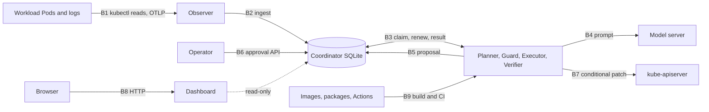

# Threat model

This describes the code as it is on this branch. It was written from the code,
not from a penetration test. Every code reference in backticks is checked by
`scripts/check_doc_citations.py`, so the document fails CI when the code it
cites moves or disappears. The residual-risk judgements are a draft: the
security and Coordinator owners still need to review and sign them off.

Sentinel runs as a lab on one host: kind nodes and containers in one Docker
Desktop VM. The trust boundaries below are real in the code, but they have
not been exercised across separate machines. The
[distributed model](distributed-model.md) covers ordering, failure and
consistency.

## Assets

| Asset | Where it lives | Why it matters |
| --- | --- | --- |
| Target Deployment's Pod template | Kubernetes; written only by `services/executor/kubernetes_adapter.py::KubectlDeploymentAPI.conditional_restore` | A bad write takes the service down or runs attacker-chosen code |
| Executor patch credential | 1 h token from `experiments/recovery/live.py:207::Experiment.prepare`; Role in `deploy/sentinel/executor-rbac.yaml` | The only Sentinel identity that can change the workload |
| Coordinator database and outbox | One SQLite file (`services/coordinator/store.py::SQLiteStore`) | Holds lifecycle state, approvals and queued commands |
| Approval grants and records | `services/coordinator/approvals.py::ApprovalAccess` | Turns an ESCALATE into permission to repair |
| Service bearer tokens | Environment variables named in config (`runtime/service_identity.py::load_identities`) | Each token is a role identity on the Coordinator |
| Executor ledger and locks | `services/executor/store.py::SQLiteExecutionLedger`, `services/executor/store.py::LocalTargetCoordinator` | Stops repeated or concurrent writes |
| Trusted Guard inputs | Policy and baseline files read by `runtime/live_executor.py::LiveGuardAuthorizer` | The Guard is only as good as these files |
| Model prompt context | `runtime/remote_adapters.py::OllamaProvider`; agent mode in `experiments/boutique/harness/agent_live.py` | Carries workload telemetry to the model |
| Lab control token | `runtime/lab_control.py::LabControl.capabilities` | Releases a fault-injection scenario |
| Images and CI | `deploy/docker/`, `.github/workflows/checks.yml` | Code that runs with the credentials above |

## Actors

| Actor | Trust |
| --- | --- |
| Operator | Trusted once authenticated by a bearer token at the approval API |
| Lab harness | Trusted. It holds the admin kube context for setup and fault injection |
| Role workers (Observer, Planner, Guard, Executor, Verifier) | Authenticated and trusted to follow the protocol. Not Byzantine-tolerant: see "Rogue worker" |
| Workload, its logs and events | Untrusted content |
| Model | Untrusted output; advisory only |
| Other Pods in the namespace | Untrusted |
| Local users and web pages in the operator's browser | Untrusted |
| Base images, packages and GitHub Actions | Partly trusted, not verified |

Out of scope: a malicious Coordinator, a compromised kube-apiserver or etcd,
root or administrator on the host, and the Docker Desktop VM itself.

## Trust boundaries

| Boundary | Transport and authentication | Code |
| --- | --- | --- |
| B1 Telemetry to Observer | kubectl with a read-only Role; optional OTLP/HTTP JSON receiver, loopback by default, bearer token off loopback, no TLS | `deploy/sentinel/observer.yaml:7-25::sentinel-observer-reader`, `runtime/otlp_receiver.py::make_receiver` |
| B2 Observer to Coordinator | Local SQLite in every recorded run; optional HTTPS `ingest` with a bearer token | `runtime/observer_pipeline.py::LocalCoordinatorSink`, `runtime/remote_worker.py::RemoteIngress` |
| B3 Coordinator and workers | HTTP on loopback or HTTPS (server certificate only) with a per-identity bearer token | `runtime/worker_http.py::handler`, `runtime/worker_transport.py::Delivery` |
| B4 Planner to model | Plain HTTP to the configured Ollama URL | `agent/llm.py::Ollama.ask` |
| B5 Planner output to Guard | Closed message contract, then Guard checks | `shared/contracts.py::validate_message`, `services/guard/core.py::_evaluate_core` |
| B6 Approval API | Same token scheme as B3, on its own port and with its own credentials | `runtime/approval_http.py::handler`, `runtime/coordinator_server.py:70-71::main` |
| B7 Executor to kube-apiserver | kubectl with a restricted kubeconfig | `services/executor/kubernetes_adapter.py::KubectlDeploymentAPI` |
| B8 Dashboard and browser | Loopback HTTP, no user login | `runtime/dashboard.py::make_server` |
| B9 Supply chain | Docker builds and GitHub Actions | `deploy/docker/coordinator.Dockerfile`, `.github/workflows/checks.yml` |

## Threats, controls and residual risk

STRIDE letters: S spoofing, T tampering, R repudiation, I information
disclosure, D denial of service, E elevation of privilege. "Roadmap" names the
item in the remediation plan that addresses the residual risk, or says there is
none yet.

| Boundary and threat | Existing controls | Tests | Residual risk | Roadmap |
| --- | --- | --- | --- | --- |
| B1/B4 T, E: a malicious log line steers the model (prompt injection) | Model output is advisory. The Planner keeps ROLLBACK only if it names an eligible saved baseline, and keeps only evidence ids from the incident (`services/planner/core.py:115-120::propose`). The Guard enforces the target and action allowlist (`services/guard/core.py:157-162::_state_policy_reasons`), the baseline hash (`services/guard/core.py:110-111::_baseline_reasons`) and refuses a rollback that changes nothing (`services/guard/decisions.py::_rollback_change_checks`). The system prompt says telemetry is data (`agent/llm.py::Ollama.ask`), which is not a control | `tests/test_planner.py::PlannerTests.test_provider_cannot_change_identity_select_another_template_or_invent_evidence`, `tests/test_guard_necessity.py::GuardNecessityTests.test_healthy_approved_identical_template_is_rejected` | In agent mode raw log text reaches the model: each logs tool call returns up to 15 example lines of up to 500 characters (`agent/tools.py:193-194::Telemetry.run`). The model can be steered to ROLLBACK whenever the live template differs from the baseline, and the Guard allows it if the other checks pass. It can also be steered to ESCALATE, which blocks automated repair | P2.04, P2.05 |
| B1 S, T: forged OTLP telemetry | Loopback bind by default; a token is required to bind elsewhere; body and decompressed size are capped at 1 MB (`runtime/otlp_receiver.py::make_receiver`) | none cited | Off loopback the token travels over plain HTTP. Anything that can reach the port with the token can add telemetry | none yet |
| B3 S, E: a rogue or compromised worker holding a role token | Tokens are at least 32 printable characters, distinct per identity and compared in constant time (`runtime/service_identity.py::load_identities`, `runtime/service_identity.py::authenticate`). Each role can claim only its own topics and ingest only its own message kind (`runtime/worker_transport.py::TOPICS`, `runtime/worker_transport.py::INGRESS`). Renew and result need the same owner, role and lease token (`runtime/worker_transport.py::Delivery.renew`, `runtime/worker_transport.py::Delivery.finish`). A result must match the claimed request's ids, and a Guard result needs a report bound to current evidence (`runtime/worker_transport.py:157-180::Delivery.finish`). Protected approvals are removed from generic deliveries (`runtime/worker_transport.py:96-99::Delivery.claim`). The Coordinator's lifecycle checks still apply (`services/coordinator/core.py::_apply`). The Executor ignores the delivered Guard decision and re-runs the Guard locally with its own policy, baseline and approval lookup before writing (`runtime/remote_adapters.py::ExecutorAdapter.process`, `services/executor/core.py:214::execute`) | `tests/test_worker_transport.py::TransportTests.test_timeout_backoff_and_role_fences`, `tests/test_worker_transport.py::TransportTests.test_renew_cannot_revive_expired_replaced_or_wrong_role_work`, `tests/test_worker_guard_handoff.py::WorkerGuardHandoffTests.test_managed_approval_is_not_exposed_in_generic_worker_delivery`, `tests/test_approval_access.py::ApprovalAccessTests.test_shared_identity_loader_uses_environment_and_rejects_weak_or_reused_tokens` | A bearer token can be replayed by anyone who copies it, until it is rotated by restarting with a new Secret. There is no mTLS, so the Coordinator cannot tell which machine a token came from. A rogue Verifier can report a false RECOVERED outcome or a clear dependency finding. A rogue Observer can open incidents for any target, because ingest is not scoped by target. A rogue Executor token can report APPLIED without a write; the Verifier still measures health. There is no rate limit, and the HTTP server starts one thread per connection | P3.04 (per-target ownership); mTLS for the Coordinator is not on the roadmap |
| B5 E: a proposal tries to do more than restore a saved template | The contract has no free-form command (`shared/contracts.py::validate_message`). Only ROLLBACK is implemented (`services/guard/core.py:161-162::_state_policy_reasons`). The Guard checks live UID and resourceVersion, baseline identity, dependency findings, security and resource rules, and gives each decision a short validity window (`services/guard/eligibility.py::_security`, `services/guard/decisions.py::_valid_until`). Approval cannot rescue a hard rejection (`services/guard/core.py:239-244::_evaluate_core`) | `tests/test_executor.py::ExecutorTests.test_operator_approval_cannot_override_hard_guard_rejection`, `tests/test_coordinator.py::CoordinatorTests.test_rejection_cannot_be_overridden_by_approval_or_later_allow` | The Guard trusts its policy and baseline files as given; their integrity rests on file permissions. Live recorded runs cover one fault type where ROLLBACK is right (`C-CONNECTED-HARNESS`) and one refused unnecessary rollback (`C-GUARD-REJECTION`) | P2.08, P3.08 |
| B6 S, E: a stolen operator token or a stale approval | Grants name the exact target including its UID, with no wildcards (`services/coordinator/approvals.py::load_permissions`). Guard and Executor identities may only read (`services/coordinator/approvals.py::ROLES`). Creation is bound to the proposal digest and policy version, and its lifetime is capped (300 s by default) (`services/coordinator/approvals.py:61-65::ApprovalAccess.call`). Approval cannot override a state, dependency or policy escalation (`services/coordinator/core.py:235-236::approve`). Guard and Executor look the approval up again before acting, and an unreachable authority fails closed (`runtime/live_executor.py::LiveGuardAuthorizer.assert_usable`) | `tests/test_approval_access.py::ApprovalAccessTests.test_invalid_credentials_and_wrong_target_cannot_create_read_revoke_or_audit`, `tests/test_approval_access.py::ApprovalAccessTests.test_bound_creation_rejects_changed_proposal_policy_identity_and_excessive_expiry`, `tests/test_approval_access.py::ApprovalAccessTests.test_final_remote_lookup_fails_closed_when_authority_becomes_unavailable` | A revocation that lands after the Executor's final lookup can race with a patch already being sent ([approvals](approvals.md#revocation-cutoff-and-remaining-race)). No live run has used this API: the harnesses call `approve()` directly as a fixed lab operator (`experiments/recovery/live.py:325::Experiment.case`, `runtime/recovery_runner.py:35::advance`), and agent mode inherits this and labels it pre-authorised (`experiments/boutique/harness/agent_live.py:232::AgentPlanningMixin.build_proposal`). Demo approval is therefore outside this trust model | P2.02, P2.03, P3.04 |
| B6/B3 R: an operator or worker denies an action | Approvals and revocations store the authenticated identity as `operator_id`. A transport receipt records the identity that claimed each request, but receipts are deleted after the retention period, 24 h by default (`runtime/worker_transport.py:61-63::Delivery.transaction`) | `tests/test_approval_access.py::ApprovalAccessTests.test_revocation_persists_restart_retires_work_and_allows_new_bound_approval` | The HTTP handlers write no access or authentication-failure log on this branch (`runtime/approval_http.py::handler`). The database can be edited by anyone with file access | P1.07 |
| B7 T: a stale or racing writer | One JSON Patch tests the UID and resourceVersion before replacing the template (`services/executor/kubernetes_adapter.py:174-176::KubectlDeploymentAPI.conditional_restore`). Targets must be on a trusted allowlist (`services/executor/kubernetes_adapter.py::KubectlDeploymentAPI._target`). A per-target OS lock and a write-intent journal stop a repeated write (`services/executor/core.py:229-238::execute`) | `tests/test_k8s_executor_adapter.py::KubernetesExecutorAdapterTests.test_restore_patches_exact_template_and_evidence_with_both_atomic_tests`, `tests/test_k8s_executor_adapter.py::KubernetesExecutorAdapterTests.test_stale_version_or_uid_is_definitely_a_zero_write_local_conflict`, `tests/test_executor.py::ExecutorTests.test_crash_after_write_intent_but_before_commit_does_not_repeat_mutation` | The lock covers one host only. A writer whose read is still current can write after its lease expired or its approval was revoked, because nobody else changed the resourceVersion | P1.10, P2.06, P3.04 |
| B7 E: theft of the Executor credential | The Role allows only get and patch on one named Deployment (`deploy/sentinel/executor-rbac.yaml:17-21::resourceNames`). The token lasts 1 h and is written to a private file (`experiments/recovery/live.py:207::Experiment.prepare`). The ServiceAccount token is not mounted (`deploy/sentinel/executor-rbac.yaml:10::automountServiceAccountToken: false`) | `tests/test_k8s_executor_adapter.py::KubernetesExecutorAdapterTests.test_disallowed_target_and_option_like_names_are_refused_before_any_command` | RBAC cannot limit fields. For up to an hour the token can patch anything in that Deployment, including image, command and service account | P3.05 |
| Namespace peers S, I: a compromised Pod next to the workload | Normal connected recovery installs no NetworkPolicy. The optional security lab protects only the shipping route, through an mTLS gateway (`scripts/security/boutique_security_manifest.py`, `C-SECURITY-LAB`) | `tests/test_security_connected.py` | Other Boutique services accept plaintext gRPC from any Pod in the namespace | P4.06, P5.04 |
| B8 S, I: a local user, or a web page using DNS rebinding | Loopback bind, or an explicit all-interfaces bind inside a container published on host loopback (`runtime/dashboard.py::make_server`). The default server has no mutation routes and opens the database read-only (`runtime/dashboard.py::_open_readonly`). Responses send a strict CSP, nosniff and no-store (`runtime/dashboard.py::make_server.Handler._respond`). With lab controls on, the Host header must be loopback, and POST to the inject route needs a same-origin Origin, the per-session token, JSON and at most 2 KB (`runtime/dashboard.py::make_server.LabHandler.do_POST`). The lab can only release a fixed scenario in an allowlisted lab (`runtime/lab_control.py::SCOPES`) | `tests/test_lab_control.py::LabControlHTTPTests.test_only_current_authenticated_same_origin_request_releases_gate`, `tests/test_lab_control.py::LabControlHTTPTests.test_get_snapshot_exposes_state_without_control_secret`, `tests/test_dashboard.py::DashboardTests.test_http_serves_assets_and_refuses_mutations_and_traversal` | The Host check runs only when lab controls are on (`runtime/dashboard.py:148-151::make_server.Handler.do_GET`), so in read-only mode a rebinding page could read the snapshot. There is no user login: any local process can read it. The wrong-Host and untokened-inject refusals are unit-tested but not yet recorded in a live bundle | P2.03; the read-only Host check has no item yet |
| Coordinator store T, I | In the deployment manifest only the Coordinator process opens the file and no worker mounts its volume. The Pod runs as non-root with a read-only root filesystem and no API token (`deploy/sentinel/coordinator.yaml:73-81::runAsNonRoot`). The dashboard opens it read-only | `tests/test_dashboard.py::DashboardTests.test_snapshot_observes_new_messages_and_never_mutates_coordinator` | In the local lab every role process on the host opens the same file directly, so any local process with file access can rewrite lifecycle state or approvals. There is no encryption or integrity protection at rest. Restoring an older backup silently drops acknowledged results | P3.06 |
| B9 T: supply chain | The demo-runner final stage and the security inspector use digest-pinned bases (`deploy/docker/demo-runner.Dockerfile:33::@sha256`). The core harness, Guard and Executor use only the standard library (`requirements.txt`) | none | `python:3.12-slim` is not pinned in `deploy/docker/coordinator.Dockerfile:1::python:3.12-slim`, `deploy/docker/guard.Dockerfile:2::python:3.12-slim` and `deploy/docker/observer.Dockerfile:1::python:3.12-slim`; the frontend stage's Node base is not pinned; Actions are pinned by tag (`.github/workflows/checks.yml:9::actions/checkout@v6`); the pandas range has no hashes; CI has no CVE gate | P1.09, P2.09, P5.02, P5.03 |
| B4 D, I: the model server | The provider call has a timeout and at most two attempts (`agent/llm.py::Ollama.ask`) | `tests/test_llm_transport.py` | On this branch the response body is read without a size limit, and redirects and proxy settings are followed. The prompt goes to whatever URL the trusted config names; the sample configs use plain HTTP to a local Ollama (`data/sentinel/samples/rca-config.json::http://127.0.0.1:11434`) | P1.12 |

## Out of scope and not yet checked

- Byzantine or compromised Coordinator, kube-apiserver, etcd, host or VM.
- Physical machines: every recorded run used one host. Containers on one host
  are not separate machines.
- Live checks: the dashboard Host and token refusals should be recorded during
  one harness run and added to `evidence/` as a small bundle. Until then they
  rest on the unit tests above.
